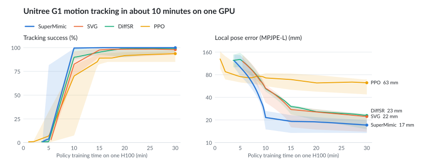

# ImitationLab

ImitationLab trains Unitree G1 motion trackers in Isaac Lab with Newton/MJWarp.
It contains the G1 task, four policy learners, two learned command encoders,
and the data tools that turn motion datasets into packed reference banks.

The public task is `imitation-g1-v1`. The command interface and the policy
learner are independent choices:

| `--interface` | Tracker input |
| --- | --- |
| `explicit` | Ten future reference frames relative to the robot |
| `fsq` | A frozen spectral skill encoder with a finite-scalar-quantized (FSQ) latent |
| `spectral` | A frozen spectral skill encoder with a continuous latent |

Both latent interfaces pretrain the same spectral skill objective: a bilinear
spectral energy ties the skill latent to the motion transition, and a
predictor keeps it predictable one chunk ahead. They differ only in whether
the latent is quantized. `--interface diffsr` remains an alias for `spectral`.

| `--policy` | Learner |
| --- | --- |
| `supermimic` (default) | BPTT through imagined world-model rollouts |
| `ppo` | Clipped policy updates from simulator rollouts |
| `svg` | Pathwise gradients along recorded simulator windows |
| `diffsr` | BPTT through a DiffSR spectral dynamics model of the low-level state |

The first release supports LAFAN1 and BONES-SEED. BONES-SEED is a separately
licensed, gated dataset; collaborators obtain it directly from Bones Studio.

## Quick start

Use Linux x86-64 with [Pixi](https://pixi.sh) 0.83 or newer and an NVIDIA GPU.
Run commands from the repository root.

```bash
pixi install --locked -e isaaclab
pixi run -e isaaclab smoke-g1
```

The smoke runs one PPO iteration on the bundled Dance102 clip. Then prepare a
motion bank and train:

```bash
pixi run -e isaaclab imitationlab train --policy supermimic --interface explicit --data "$BANK"
pixi run -e isaaclab imitationlab evaluate --checkpoint "$RUN" --data "$BANK" \
  --num-envs 4 --trajectory_ranks 0 1 2 3
```

Training sizes itself for the local GPU, memory, and motion bank. Explicit
overrides take precedence, and a resumed run keeps its saved sizes.

## Commands

| Command | Purpose |
| --- | --- |
| `imitationlab data` | Prepare, validate, and pack LAFAN1 and BONES-SEED motions |
| `imitationlab pretrain` | Pretrain an FSQ or spectral skill command encoder |
| `imitationlab train` | Train a tracker; `--dry-run` prints the resolved command |
| `imitationlab evaluate` | Evaluate a checkpoint with its saved task and network settings |
| `imitationlab export` | Export a checkpoint and its encoder as a native bundle |
| `imitationlab hardware` / `tune` | Show or measure execution sizes for this machine |
| `imitationlab benchmark` | Measure tracking quality against training time |

Run `imitationlab <command> --help` for the options of a command.

## Results

Fresh 30-minute runs on one NVIDIA H100 80 GB, seed 42, with the current
defaults. Each case trains on its motion bank and is evaluated on fixed boards:
all 40 LAFAN1 clips and 256 fixed BONES-SEED clips, each for up to 10 seconds.
The ranges cover both banks and all three interfaces.

| Learner | Final success | Final MPJPE-L | First ≥90% success with MPJPE-L ≤40 mm |
| --- | ---: | ---: | --- |
| SuperMimic (BPTT) | 99.6–100% | 13.4–19.8 mm | About 10 minutes in all six cases |
| SVG | 92.5–100% | 13.9–23.6 mm | 10–15 minutes |
| DiffSR dynamics | 95.0–100% | 15.0–24.2 mm | About 15 minutes |
| PPO | 85.0–96.1% | 43.8–69.6 mm | Not reached in 30 minutes |

<picture>
  <source media="(prefers-color-scheme: dark)" srcset="docs/benchmarks/g1-learning-speed-30min/overview-dark.svg">
  
</picture>

Lines are medians over the six cases (two motion banks × three interfaces);
bands span their range. These are single-seed measurements on training motions: they measure
acquisition, not held-out generalization. Encoder pretraining and startup add
2.6–8.2 minutes. Two follow-up studies tried to close the gaps:

- **PPO tuning.** Three stronger PPO recipes did not improve tracking
  reliably. The best screened recipe lowered local error in only two of six
  cases at a second seed, so the PPO default is unchanged. See
  [PPO tuning](docs/benchmarks/ppo-tuning.md).
- **SVG tuning.** No SVG recipe improved tracking over BPTT in both seeds in
  any of the six cases. See [SVG tuning](docs/benchmarks/svg-tuning.md).

The [full 30-minute report](docs/benchmarks/g1-learning-speed-30min/README.md)
has the per-case tables, global errors, survival, threshold times, and costs.

## Repository layout

| Path | Contents |
| --- | --- |
| [imitationlab/algorithms](imitationlab/algorithms) | Policy learners and shared learner components |
| [imitationlab/encoders](imitationlab/encoders) | Spectral skill command encoders (FSQ and continuous) |
| [imitationlab/envs/isaaclab](imitationlab/envs/isaaclab) | The G1 task, simulator adapters, task math, and robot assets |
| [imitationlab/data_tools](imitationlab/data_tools) | Dataset conversion, validation, and packed reference banks |
| [imitationlab/runners](imitationlab/runners) | Launch, training, hardware sizing, benchmarks, and cluster submission |
| [imitationlab/evaluation](imitationlab/evaluation) | Checkpoint rollouts, metrics, and export |
| [experiments/recipes](experiments/recipes) | Versioned training and encoder settings |
| [third_party/supermimic](third_party/supermimic) | Official SuperMimic baseline with its own environment |

## Documentation

Start with [setup](docs/setup.md), [motion data](data/README.md), and
[training and evaluation](docs/training.md). The [documentation index](docs/README.md)
lists hardware selection, cluster runs, architecture, migration, and all
reports. See [contributing](CONTRIBUTING.md) for the branch and test workflow.

## License

ImitationLab is MIT-licensed. Upstream components and assets keep their own
licenses; see [THIRD_PARTY_NOTICES.md](THIRD_PARTY_NOTICES.md).
