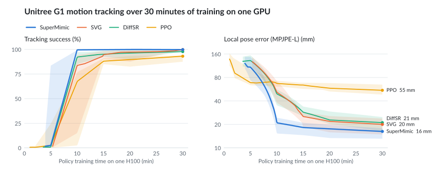

<div align="center">

# ImitationLab

**Train whole-body motion trackers for the Unitree G1 in minutes on one GPU.**

[](https://github.com/GTLIDAR/ImitationLab/actions/workflows/static-checks.yml)
[](LICENSE)
[](pixi.toml)
[](docs/setup.md)

[Quick start](#quick-start) ·
[Results](#results) ·
[Documentation](docs/README.md) ·
[Motion data](data/README.md) ·
[Contributing](CONTRIBUTING.md)

</div>

<picture>
  <source media="(prefers-color-scheme: dark)" srcset="docs/benchmarks/g1-release-check/overview-dark.svg">
  
</picture>

ImitationLab is a research codebase for humanoid motion tracking in
[Isaac Lab](https://github.com/isaac-sim/IsaacLab) with the Newton/MJWarp
physics backend. One task, four policy learners, and three ways to feed the
reference motion to the policy share a single command-line tool, so learners
and interfaces can be compared on equal terms.

## Highlights

- **Fast.** SuperMimic reaches at least 90% tracking success with at most
  40 mm local pose error after about 10 minutes of training on one H100, on
  both LAFAN1 and the 129,785-clip BONES-SEED bank.
- **Four learners, one task.** SuperMimic-style BPTT, SVG, DiffSR dynamics
  and PPO train on the same `imitation-g1-v1` observation, action and reward
  contract.
- **Explicit or latent commands.** Feed the policy future reference frames
  directly, or a frozen skill encoder's latent. Latent policies read only the
  reference motion, so they need an IMU but no position estimate on the robot.
- **Sizes itself to the GPU.** The same command trains on a 16 GB RTX 4080
  and on an H200; execution sizes are chosen from the GPU, host memory and
  motion bank.
- **Reproducible.** Locked Pixi environments, versioned recipes, and
  checkpoints that record their task, learner, interface, data identity,
  encoder weights and seed.

## Quick start

**Requirements:** Linux x86-64, an NVIDIA GPU, and
[Pixi](https://pixi.sh) 0.83 or newer. Run commands from the repository root.

```bash
git clone https://github.com/GTLIDAR/ImitationLab.git
cd ImitationLab
pixi install --locked -e isaaclab
pixi run -e isaaclab smoke-g1
```

The smoke test runs one PPO iteration on the bundled Dance102 clip. Starting
Isaac Sim requires accepting the NVIDIA Omniverse license; see
[setup](docs/setup.md).

Next, prepare a motion bank ([motion data](data/README.md)), then train and
evaluate a tracker:

```bash
pixi run -e isaaclab imitationlab train \
  --policy supermimic --interface explicit --data "$BANK"

pixi run -e isaaclab imitationlab evaluate --checkpoint "$RUN" --data "$BANK" \
  --num-envs 4 --trajectory_ranks 0 1 2 3
```

`evaluate` writes `outputs/evaluation/result.json`; pass `--overwrite` or a
new `--output` when re-running.

Explicit overrides take precedence over automatic sizing, and a resumed run
keeps its saved sizes. [Training and evaluation](docs/training.md) covers
encoder pretraining, checkpoints, export and benchmarks.

## Learners and interfaces

The policy learner and the command interface are independent choices.

| `--policy` | Learner |
| --- | --- |
| `supermimic` (default) | BPTT through imagined world-model rollouts |
| `svg` | Pathwise gradients along recorded simulator windows |
| `diffsr` | BPTT through a DiffSR spectral dynamics model of the low-level state |
| `ppo` | Clipped policy updates from simulator rollouts |

| `--interface` | Tracker input |
| --- | --- |
| `explicit` (default) | Ten future reference frames |
| `fsq` | A frozen spectral skill encoder with a finite-scalar-quantized (FSQ) latent |
| `spectral` | A frozen spectral skill encoder with a continuous latent |

Both latent interfaces pretrain the same spectral skill objective: a bilinear
spectral energy ties the skill latent to the motion transition, and a
predictor keeps it predictable one chunk ahead. They differ only in whether
the latent is quantized. `--interface diffsr` remains an alias for `spectral`.

## Commands

| Command | Purpose |
| --- | --- |
| `imitationlab data` | Prepare, validate, and pack LAFAN1 and BONES-SEED motions |
| `imitationlab pretrain` | Pretrain an FSQ or spectral skill command encoder |
| `imitationlab train` | Train a tracker; `--dry-run` prints the resolved command |
| `imitationlab evaluate` | Evaluate a checkpoint with its saved task and network settings |
| `imitationlab export` | Export a checkpoint and its encoder as a native bundle |
| `imitationlab hardware` / `tune` | Show or measure execution sizes for this machine |
| `imitationlab benchmark` | Measure tracking quality against training time |

Run `imitationlab <command> --help` for the options of a command.

## Results

30-minute runs on one NVIDIA H100 80 GB, seed 42, with the current defaults.
Each case trains on its motion bank and is evaluated on that whole bank: all 40
LAFAN1 clips or all 129,785 BONES-SEED clips, each for up to 10 seconds. The
ranges cover both banks and all three interfaces; the figure at the top shows
the same runs over time.

| Learner | Final success | Final MPJPE-L | First ≥90% success with MPJPE-L ≤40 mm |
| --- | ---: | ---: | --- |
| SuperMimic (BPTT) | 99.7–100% | 13.1–17.3 mm | About 10 minutes in all six cases |
| SVG | 97.7–100% | 14.9–23.6 mm | 10–15 minutes |
| DiffSR dynamics | 97.5–99.7% | 16.3–25.4 mm | 10–15 minutes |
| PPO | 87.5–93.9% | 48.2–64.6 mm | Not reached in 30 minutes |

In the figure, lines are medians over the six cases (two motion banks × three
interfaces) and bands span their range. Encoder pretraining and startup add
2.8–12.5 minutes.

**Scope of these numbers.** They are single-seed measurements on training
motions in simulation. They measure how fast each learner acquires tracking,
not held-out generalization, and the policies have not been validated on
hardware.

**Other GPUs.** The same 24 cases were run on four GPUs, from a 16 GB RTX 4080
to an H200. SuperMimic reaches 99.4–99.9% success on the full BONES-SEED bank
on every tier. See the
[four-tier release check](docs/benchmarks/g1-release-check.md).

**Further reports.**

- [PPO tuning](docs/benchmarks/ppo-tuning.md): three stronger PPO recipes did
  not improve tracking reliably, so the PPO default is unchanged.
- [SVG tuning](docs/benchmarks/svg-tuning.md): no SVG recipe improved tracking
  over BPTT in both seeds in any of the six cases.
- [Earlier 30-minute H100 report](docs/benchmarks/g1-learning-speed-30min/README.md):
  per-case survival, threshold times and costs. Its latent policies used the
  first-release encoder window, which also reads the robot's position.

## Motion data

| Dataset | Clips | Access |
| --- | ---: | --- |
| [LAFAN1, retargeted to G1](https://huggingface.co/datasets/lvhaidong/LAFAN1_Retargeting_Dataset) | 40 | Public download |
| [BONES-SEED](https://huggingface.co/datasets/bones-studio/seed) | 129,785 | Gated; separately licensed by Bones Studio |

No motion data beyond one Unitree Dance102 clip is distributed with this
repository. `imitationlab data` downloads or converts each dataset into a
packed reference bank; see [motion data](data/README.md). Review the
BONES-SEED license before sharing weights or other results trained on it.

## Documentation

| Guide | Contents |
| --- | --- |
| [Setup](docs/setup.md) | Pixi environments, Isaac Lab, and the optional official SuperMimic runner |
| [Motion data](data/README.md) | LAFAN1 and BONES-SEED preparation and packed reference banks |
| [Training and evaluation](docs/training.md) | Commands, learners, interfaces, checkpoints, export, and benchmarks |
| [Hardware selection](docs/hardware.md) | Automatic execution sizes and local throughput tuning |
| [Running on a Slurm cluster](docs/cluster.md) | Profiles, campaigns, and the plan/submit workflow |
| [Architecture](docs/architecture.md) | Package boundaries and module ownership |

The [documentation index](docs/README.md) lists every guide and report.

## Repository layout

| Path | Contents |
| --- | --- |
| [imitationlab/algorithms](imitationlab/algorithms) | Policy learners and shared learner components |
| [imitationlab/encoders](imitationlab/encoders) | Spectral skill command encoders (FSQ and continuous) |
| [imitationlab/envs/isaaclab](imitationlab/envs/isaaclab) | The G1 task, simulator adapters, task math, and robot assets |
| [imitationlab/data_tools](imitationlab/data_tools) | Dataset conversion, validation, and packed reference banks |
| [imitationlab/runners](imitationlab/runners) | Launch, training, hardware sizing, benchmarks, and cluster submission |
| [imitationlab/evaluation](imitationlab/evaluation) | Checkpoint rollouts, metrics, and export |
| [experiments/recipes](experiments/recipes) | Versioned training and encoder settings |
| [third_party/supermimic](third_party/supermimic) | Official SuperMimic baseline with its own environment |

## Contributing

Contributions are welcome. Branch from `main`, run the CPU tests and static
checks, and open a pull request:

```bash
pixi install --locked
pixi run test-default
pixi run -e static ci-static
```

[CONTRIBUTING.md](CONTRIBUTING.md) describes the workflow, where code belongs,
and what to record when reporting results. Please use
[GitHub issues](https://github.com/GTLIDAR/ImitationLab/issues) for bugs and
questions.

## Acknowledgments

ImitationLab builds on [Isaac Lab](https://github.com/isaac-sim/IsaacLab) and
Newton/MJWarp, includes the official
[SuperMimic](https://github.com/HybridRobotics/supermimic) baseline, and
adapts components credited in
[THIRD_PARTY_NOTICES.md](THIRD_PARTY_NOTICES.md). Source revisions are listed
in [provenance](docs/provenance.md). Motion data comes from the Unitree
retargeting of LAFAN1 and from Bones Studio's BONES-SEED.

## License

ImitationLab is released under the [MIT License](LICENSE). Upstream components
and assets keep their own licenses; see
[THIRD_PARTY_NOTICES.md](THIRD_PARTY_NOTICES.md). Motion datasets are licensed
separately by their owners.
