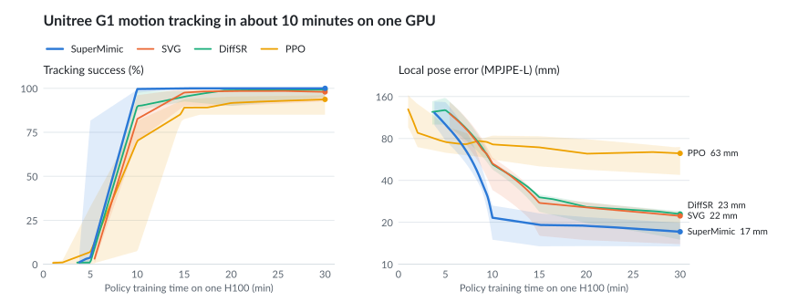
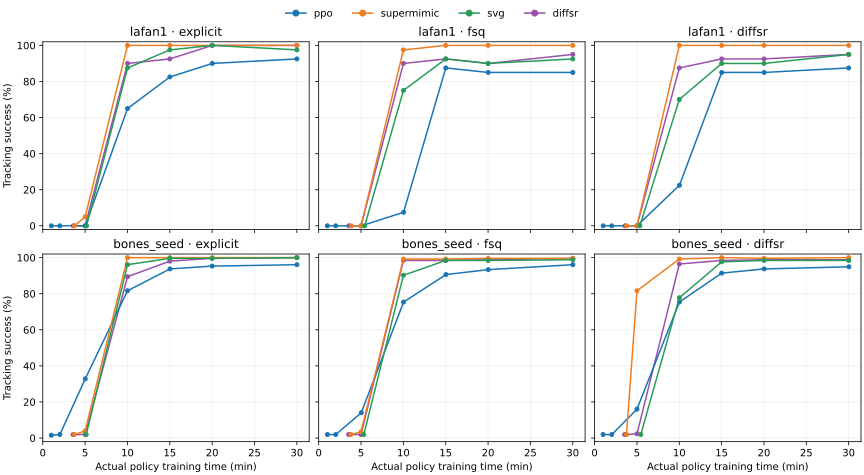
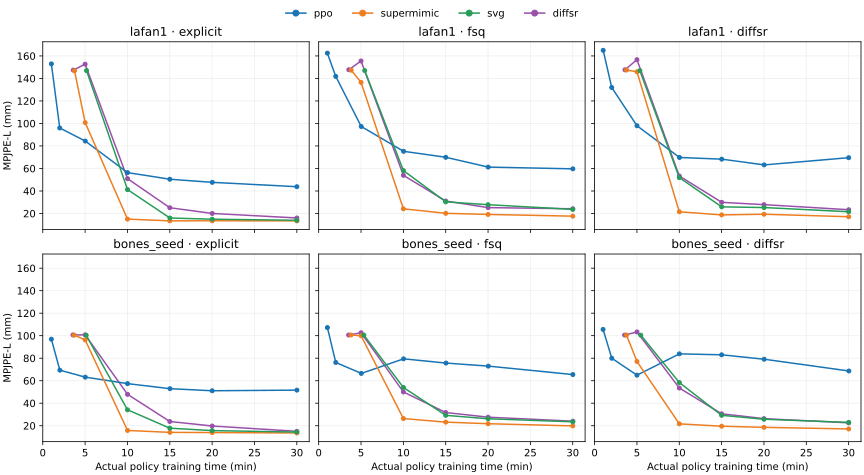

# G1 learning speed: 30 minutes

All 24 combinations completed fresh 1,800-second policy runs on NVIDIA H100
80 GB GPUs, seed 42, using the defaults fixed before launch. All four fresh
encoders completed 2,000 updates. Every run passed the artifact and provenance
audit. Completion establishes that training ran; tracking quality is measured below.

The PPO arm uses normalized vanilla PPO with `[512, 256, 128]` ELU networks.
Its prior tuning covered normalization and environment count; it did not
search the optimizer, exploration, rollout/update geometry or network capacity.
These measurements establish the shipped baseline, not a fully tuned PPO bound.

SuperMimic meets the joint target of at least 90% success and at most 40 mm
local MPJPE at the approximately ten-minute checkpoint in every case. SVG
meets it at ten minutes for BONES-SEED explicit and fifteen minutes for the
other five; DiffSR meets it at fifteen minutes in all six. PPO never meets
that joint target within the saved thirty-minute trajectories, despite
improving final success to 85.0–96.1%.

At the final checkpoint, SuperMimic has 99.6–100% success and 13.4–19.8 mm
local error; SVG has 92.5–100% and 13.9–23.6 mm; DiffSR has 95.0–100% and
15.0–24.2 mm. PPO's local error remains 43.8–69.6 mm and global error
294.6–754.5 mm. These one-seed results support the measured time-to-quality
comparison, not a statistically reliable ranking or generalization claim.

The report retains regressions: LAFAN1 explicit SVG falls from 100% success
at twenty minutes to 97.5% at thirty; LAFAN1 FSQ PPO falls from 87.5% at
fifteen minutes to 85.0%. LAFAN1 spectral-command PPO's local error rises from
63.2 mm at twenty minutes to 69.6 mm at thirty. No row substitutes its best
checkpoint for its final result.

Time-to-target reporting corrects float32 rounding at exact 90% and 95%
success boundaries. Original threshold records are retained in the aggregate
JSON wherever they differ; the underlying measurements and checkpoints are unchanged.

- [Protocol and source snapshot](../g1-learning-speed-30min.md)
- [Aggregate measurements and encoder records](summary.json)
- [Audit result](audit.json)
- [Previous ten-minute study and all follow-ups](../g1-learning-speed/README.md)

## Final checkpoints

Each row uses the final checkpoint for every metric. Training time is the
actual saved clock; end-to-end time adds encoder pretraining and policy startup,
excluding queueing and evaluation. Mean survival ends at natural clip completion,
so BONES-SEED can have high success with a mean below ten seconds.

| Dataset | Command | Learner | Train s | Success % | L/G mm | Survival s | End-to-end min |
| --- | --- | --- | ---: | ---: | ---: | ---: | ---: |
| lafan1 | explicit | ppo | 1800.37 | 92.5 | 43.8 / 294.6 | 9.88 | 32.64 |
| lafan1 | explicit | supermimic | 1800.54 | 100.0 | 13.4 / 43.5 | 10.00 | 33.00 |
| lafan1 | explicit | svg | 1800.47 | 97.5 | 13.9 / 58.9 | 9.99 | 32.97 |
| lafan1 | explicit | diffsr | 1800.40 | 100.0 | 16.0 / 70.2 | 10.00 | 33.03 |
| lafan1 | fsq | ppo | 1800.86 | 85.0 | 59.7 / 463.7 | 9.52 | 37.84 |
| lafan1 | fsq | supermimic | 1800.44 | 100.0 | 17.6 / 44.6 | 10.00 | 38.22 |
| lafan1 | fsq | svg | 1800.38 | 92.5 | 23.6 / 58.4 | 9.89 | 38.02 |
| lafan1 | fsq | diffsr | 1800.53 | 95.0 | 24.2 / 64.3 | 9.97 | 38.01 |
| lafan1 | spectral | ppo | 1800.14 | 87.5 | 69.6 / 445.2 | 9.80 | 36.08 |
| lafan1 | spectral | supermimic | 1800.35 | 100.0 | 17.1 / 40.8 | 10.00 | 36.58 |
| lafan1 | spectral | svg | 1800.37 | 95.0 | 21.5 / 48.6 | 9.97 | 36.32 |
| lafan1 | spectral | diffsr | 1800.28 | 95.0 | 23.3 / 56.9 | 9.96 | 36.31 |
| bones_seed | explicit | ppo | 1800.83 | 96.1 | 51.6 / 674.4 | 5.88 | 32.64 |
| bones_seed | explicit | supermimic | 1800.41 | 100.0 | 13.6 / 61.7 | 5.96 | 33.13 |
| bones_seed | explicit | svg | 1800.23 | 100.0 | 14.4 / 69.5 | 5.96 | 33.02 |
| bones_seed | explicit | diffsr | 1800.44 | 100.0 | 15.0 / 88.4 | 5.96 | 33.96 |
| bones_seed | fsq | ppo | 1800.94 | 96.1 | 65.5 / 754.5 | 5.86 | 35.98 |
| bones_seed | fsq | supermimic | 1800.49 | 99.6 | 19.8 / 65.5 | 5.95 | 37.06 |
| bones_seed | fsq | svg | 1800.53 | 98.8 | 23.5 / 97.7 | 5.93 | 36.98 |
| bones_seed | fsq | diffsr | 1801.01 | 99.6 | 24.0 / 95.1 | 5.95 | 36.99 |
| bones_seed | spectral | ppo | 1801.64 | 94.9 | 68.6 / 729.7 | 5.80 | 37.80 |
| bones_seed | spectral | supermimic | 1800.37 | 100.0 | 17.1 / 49.2 | 5.96 | 38.11 |
| bones_seed | spectral | svg | 1800.31 | 98.4 | 22.9 / 89.9 | 5.93 | 37.87 |
| bones_seed | spectral | diffsr | 1800.37 | 98.8 | 22.6 / 86.1 | 5.94 | 37.84 |

## First observed time to quality

Times below are training minutes at the first saved checkpoint meeting the
target. The joint target requires both at least 90% success and local MPJPE
at most 40 mm at that same checkpoint. A crossing does not imply the policy
maintains that quality later; compare the final checkpoint and full curves.

| Dataset | Command | Learner | ≥50% | ≥90% | ≥95% | ≥90% + L≤40 mm | Joint target end-to-end min |
| --- | --- | --- | ---: | ---: | ---: | ---: | ---: |
| lafan1 | explicit | ppo | 10.01 | 20.02 | not reached | not reached | not reached |
| lafan1 | explicit | supermimic | 10.01 | 10.01 | 10.01 | 10.01 | 12.99 |
| lafan1 | explicit | svg | 10.01 | 15.01 | 15.01 | 15.01 | 17.97 |
| lafan1 | explicit | diffsr | 10.01 | 10.01 | 20.01 | 15.00 | 18.02 |
| lafan1 | fsq | ppo | 15.01 | not reached | not reached | not reached | not reached |
| lafan1 | fsq | supermimic | 10.00 | 10.00 | 10.00 | 10.00 | 18.21 |
| lafan1 | fsq | svg | 10.00 | 15.00 | not reached | 15.00 | 23.02 |
| lafan1 | fsq | diffsr | 10.01 | 10.01 | 30.01 | 15.00 | 23.00 |
| lafan1 | spectral | ppo | 15.01 | not reached | not reached | not reached | not reached |
| lafan1 | spectral | supermimic | 10.01 | 10.01 | 10.01 | 10.01 | 16.58 |
| lafan1 | spectral | svg | 10.00 | 15.01 | 30.01 | 15.01 | 21.33 |
| lafan1 | spectral | diffsr | 10.00 | 15.01 | 30.00 | 15.01 | 21.31 |
| bones_seed | explicit | ppo | 10.01 | 15.02 | 20.01 | not reached | not reached |
| bones_seed | explicit | supermimic | 10.01 | 10.01 | 10.01 | 10.01 | 13.13 |
| bones_seed | explicit | svg | 10.00 | 10.00 | 10.00 | 10.00 | 13.02 |
| bones_seed | explicit | diffsr | 10.01 | 15.00 | 15.00 | 15.00 | 18.96 |
| bones_seed | fsq | ppo | 10.03 | 15.03 | 30.02 | not reached | not reached |
| bones_seed | fsq | supermimic | 10.00 | 10.00 | 10.00 | 10.00 | 17.06 |
| bones_seed | fsq | svg | 10.01 | 10.01 | 15.00 | 15.00 | 21.97 |
| bones_seed | fsq | diffsr | 10.00 | 10.00 | 10.00 | 15.00 | 21.97 |
| bones_seed | spectral | ppo | 10.01 | 15.00 | not reached | not reached | not reached |
| bones_seed | spectral | supermimic | 5.00 | 10.00 | 10.00 | 10.00 | 18.11 |
| bones_seed | spectral | svg | 10.01 | 15.00 | 15.00 | 15.00 | 22.87 |
| bones_seed | spectral | diffsr | 10.01 | 10.01 | 10.01 | 15.00 | 22.83 |

## Timed checkpoints

Each cell is **success % / MPJPE-L mm @ actual training minutes**. Columns
select the first checkpoint at or after the requested time. Compilation can
cross multiple milestones; repeated cells refer to one checkpoint. The final
table above uses the last checkpoint, which can differ slightly from the first
save after 1,800 seconds. No threshold crossing is interpolated.

## lafan1

| Learner / command | ≥1 min | ≥2 min | ≥5 min | ≥10 min | ≥15 min | ≥20 min | ≥30 min | First ≥90% success |
| --- | --- | --- | --- | --- | --- | --- | --- | --- |
| ppo / explicit | 0.0% / 153.0 @ 1.02 | 0.0% / 96.0 @ 2.01 | 0.0% / 84.4 @ 5.02 | 65.0% / 56.3 @ 10.01 | 82.5% / 50.4 @ 15.00 | 90.0% / 47.7 @ 20.02 | 92.5% / 43.8 @ 30.01 | 20.02 min |
| supermimic / explicit | 0.0% / 146.9 @ 3.75 | 0.0% / 146.9 @ 3.75 | 5.0% / 100.7 @ 5.01 | 100.0% / 15.0 @ 10.01 | 100.0% / 13.5 @ 15.00 | 100.0% / 13.5 @ 20.00 | 100.0% / 13.4 @ 30.01 | 10.01 min |
| svg / explicit | 0.0% / 147.0 @ 5.17 | 0.0% / 147.0 @ 5.17 | 0.0% / 147.0 @ 5.17 | 87.5% / 41.2 @ 10.01 | 97.5% / 16.0 @ 15.01 | 100.0% / 14.9 @ 20.00 | 97.5% / 13.9 @ 30.01 | 15.01 min |
| diffsr / explicit | 0.0% / 147.4 @ 3.60 | 0.0% / 147.4 @ 3.60 | 0.0% / 152.7 @ 5.00 | 90.0% / 50.9 @ 10.01 | 92.5% / 25.1 @ 15.00 | 100.0% / 20.0 @ 20.01 | 100.0% / 16.0 @ 30.01 | 10.01 min |
| ppo / fsq | 0.0% / 162.5 @ 1.03 | 0.0% / 141.8 @ 2.02 | 0.0% / 97.3 @ 5.02 | 7.5% / 75.2 @ 10.02 | 87.5% / 69.9 @ 15.01 | 85.0% / 61.2 @ 20.01 | 85.0% / 59.7 @ 30.01 | not reached |
| supermimic / fsq | 0.0% / 147.3 @ 3.84 | 0.0% / 147.3 @ 3.84 | 0.0% / 136.5 @ 5.01 | 97.5% / 24.1 @ 10.00 | 100.0% / 20.1 @ 15.00 | 100.0% / 19.2 @ 20.00 | 100.0% / 17.6 @ 30.01 | 10.00 min |
| svg / fsq | 0.0% / 147.0 @ 5.44 | 0.0% / 147.0 @ 5.44 | 0.0% / 147.0 @ 5.44 | 75.0% / 58.1 @ 10.00 | 92.5% / 30.3 @ 15.00 | 90.0% / 27.8 @ 20.00 | 92.5% / 23.6 @ 30.01 | 15.00 min |
| diffsr / fsq | 0.0% / 147.7 @ 3.56 | 0.0% / 147.7 @ 3.56 | 0.0% / 155.5 @ 5.00 | 90.0% / 53.9 @ 10.01 | 92.5% / 31.1 @ 15.00 | 90.0% / 25.2 @ 20.01 | 95.0% / 24.2 @ 30.01 | 10.01 min |
| ppo / spectral | 0.0% / 165.0 @ 1.02 | 0.0% / 132.0 @ 2.02 | 0.0% / 97.9 @ 5.00 | 22.5% / 69.8 @ 10.02 | 85.0% / 68.3 @ 15.01 | 85.0% / 63.2 @ 20.02 | 87.5% / 69.6 @ 30.00 | not reached |
| supermimic / spectral | 0.0% / 147.5 @ 3.78 | 0.0% / 147.5 @ 3.78 | 0.0% / 145.9 @ 5.01 | 100.0% / 21.5 @ 10.01 | 100.0% / 18.7 @ 15.01 | 100.0% / 19.3 @ 20.00 | 100.0% / 17.1 @ 30.01 | 10.01 min |
| svg / spectral | 0.0% / 146.9 @ 5.35 | 0.0% / 146.9 @ 5.35 | 0.0% / 146.9 @ 5.35 | 70.0% / 51.9 @ 10.00 | 90.0% / 25.9 @ 15.01 | 90.0% / 25.3 @ 20.01 | 95.0% / 21.5 @ 30.01 | 15.01 min |
| diffsr / spectral | 0.0% / 147.7 @ 3.59 | 0.0% / 147.7 @ 3.59 | 0.0% / 156.7 @ 5.00 | 87.5% / 53.3 @ 10.00 | 92.5% / 29.9 @ 15.01 | 92.5% / 27.8 @ 20.01 | 95.0% / 23.3 @ 30.00 | 15.01 min |

## bones_seed

| Learner / command | ≥1 min | ≥2 min | ≥5 min | ≥10 min | ≥15 min | ≥20 min | ≥30 min | First ≥90% success |
| --- | --- | --- | --- | --- | --- | --- | --- | --- |
| ppo / explicit | 1.6% / 96.9 @ 1.01 | 2.0% / 69.4 @ 2.02 | 32.8% / 63.2 @ 5.02 | 81.6% / 57.4 @ 10.01 | 93.8% / 52.9 @ 15.02 | 95.3% / 51.1 @ 20.01 | 96.1% / 51.6 @ 30.01 | 15.02 min |
| supermimic / explicit | 2.0% / 100.5 @ 3.72 | 2.0% / 100.5 @ 3.72 | 3.9% / 96.3 @ 5.00 | 100.0% / 15.8 @ 10.01 | 100.0% / 14.1 @ 15.01 | 100.0% / 13.9 @ 20.01 | 100.0% / 13.6 @ 30.01 | 10.01 min |
| svg / explicit | 2.0% / 100.4 @ 5.13 | 2.0% / 100.4 @ 5.13 | 2.0% / 100.4 @ 5.13 | 96.1% / 34.1 @ 10.00 | 99.6% / 17.8 @ 15.00 | 99.6% / 15.7 @ 20.00 | 100.0% / 14.4 @ 30.00 | 10.00 min |
| diffsr / explicit | 2.0% / 100.7 @ 3.56 | 2.0% / 100.7 @ 3.56 | 2.0% / 100.7 @ 5.01 | 89.5% / 47.9 @ 10.01 | 98.0% / 23.7 @ 15.00 | 99.6% / 19.7 @ 20.01 | 100.0% / 15.0 @ 30.01 | 15.00 min |
| ppo / fsq | 2.0% / 107.2 @ 1.03 | 2.0% / 76.2 @ 2.02 | 14.1% / 66.5 @ 5.03 | 75.4% / 79.4 @ 10.03 | 90.6% / 75.7 @ 15.03 | 93.4% / 73.0 @ 20.03 | 96.1% / 65.5 @ 30.02 | 15.03 min |
| supermimic / fsq | 2.0% / 100.6 @ 3.81 | 2.0% / 100.6 @ 3.81 | 3.5% / 100.0 @ 5.01 | 99.2% / 26.4 @ 10.00 | 99.2% / 23.2 @ 15.00 | 99.6% / 21.8 @ 20.00 | 99.6% / 19.8 @ 30.01 | 10.00 min |
| svg / fsq | 2.0% / 100.5 @ 5.33 | 2.0% / 100.5 @ 5.33 | 2.0% / 100.5 @ 5.33 | 90.2% / 54.0 @ 10.01 | 98.4% / 29.2 @ 15.00 | 98.4% / 26.2 @ 20.01 | 98.8% / 23.5 @ 30.01 | 10.01 min |
| diffsr / fsq | 2.0% / 100.6 @ 3.54 | 2.0% / 100.6 @ 3.54 | 2.0% / 102.6 @ 5.01 | 98.4% / 50.0 @ 10.00 | 98.4% / 31.7 @ 15.00 | 98.8% / 27.6 @ 20.00 | 99.6% / 24.0 @ 30.02 | 10.00 min |
| ppo / spectral | 2.0% / 105.6 @ 1.00 | 2.0% / 80.0 @ 2.03 | 16.0% / 64.9 @ 5.00 | 75.4% / 83.9 @ 10.01 | 91.4% / 83.0 @ 15.00 | 93.8% / 79.1 @ 20.02 | 94.9% / 68.6 @ 30.03 | 15.00 min |
| supermimic / spectral | 2.0% / 100.6 @ 3.77 | 2.0% / 100.6 @ 3.77 | 81.6% / 77.1 @ 5.00 | 99.2% / 21.7 @ 10.00 | 100.0% / 19.6 @ 15.00 | 99.6% / 18.6 @ 20.00 | 100.0% / 17.1 @ 30.01 | 10.00 min |
| svg / spectral | 2.0% / 100.5 @ 5.46 | 2.0% / 100.5 @ 5.46 | 2.0% / 100.5 @ 5.46 | 77.7% / 58.4 @ 10.01 | 97.7% / 29.3 @ 15.00 | 98.4% / 25.7 @ 20.00 | 98.4% / 22.9 @ 30.01 | 15.00 min |
| diffsr / spectral | 2.0% / 100.6 @ 3.55 | 2.0% / 100.6 @ 3.55 | 2.3% / 103.3 @ 5.01 | 96.5% / 53.5 @ 10.01 | 98.4% / 30.6 @ 15.00 | 98.8% / 26.3 @ 20.00 | 98.8% / 22.6 @ 30.01 | 10.01 min |

## Protocol and limits

Recorded training budgets (seconds): [1800.0]; seeds: [42]; task: `imitation-g1-v1`. Requested checkpoint times (seconds): [60.0, 120.0, 300.0, 600.0, 900.0, 1200.0, 1800.0]. Save at completed iteration boundaries and use the checkpoint clock, including learner compilation and checkpoint overhead. Startup ends after the first collected batch and is recorded separately. No evaluation runs inside the training clock. Model and execution settings are retained in each run's metadata.

Evaluate deterministic actions from frame zero without noise or randomization to the recorded horizon, or natural clip completion if shorter. The board sizes and horizons are listed below. These are training motions: this measures acquisition, not held-out generalization or full-bank coverage.

Success means no root tracking failure: absolute root-height error ≤0.25 m and absolute root R[2,2] error ≤0.8. MPJPE-L and MPJPE-G aggregate valid transitions before termination across the whole board, so failed runs contribute shorter trajectories. Read pose error together with success and survival time; lower error alone does not establish better tracking.

Threshold times are the first sampled checkpoints meeting the target, without interpolation. Success comparisons allow 1e-7 absolute float32 representation error; displayed measurements are unchanged. “Not reached” means no saved checkpoint met the target within this run; a transient crossing between checkpoints is unknown. One seed does not establish a statistically reliable learner ranking.

FSQ and spectral each use a dataset-specific frozen encoder; its pretraining record includes the update count and architecture. Encoder process time and policy startup are added separately for end-to-end time; queueing and evaluation are excluded. Reusing an encoder amortizes its cost across policies. All timing is specific to the recorded hardware, software, source snapshot, and compiler cache state. The cluster sweep uses separate cold compiler caches per job.

Raw BONES-SEED data, per-motion results, and model weights stay outside Git. Only aggregate measurements and hashes are published here.

## Cost and resolved execution

| Dataset | Command | Learner | Profile | Envs | Encoder min | Startup min | Last train min | Last end-to-end min | MPJPE-G mm | Mean survival s |
| --- | --- | --- | --- | --- | --- | --- | --- | --- | --- | --- |
| bones_seed | spectral | diffsr | standard | 4096 | 4.98 | 2.85 | 30.01 | 37.84 | 86.1 | 5.94 |
| bones_seed | spectral | ppo | large | 8192 | 4.98 | 2.79 | 30.03 | 37.80 | 729.7 | 5.80 |
| bones_seed | spectral | supermimic | large | 8192 | 4.98 | 3.12 | 30.01 | 38.11 | 49.2 | 5.96 |
| bones_seed | spectral | svg | standard | 4096 | 4.98 | 2.88 | 30.01 | 37.87 | 89.9 | 5.93 |
| bones_seed | explicit | diffsr | xlarge | 16384 | 0.00 | 3.96 | 30.01 | 33.96 | 88.4 | 5.96 |
| bones_seed | explicit | ppo | large | 8192 | 0.00 | 2.63 | 30.01 | 32.64 | 674.4 | 5.88 |
| bones_seed | explicit | supermimic | xlarge | 16384 | 0.00 | 3.12 | 30.01 | 33.13 | 61.7 | 5.96 |
| bones_seed | explicit | svg | xlarge | 16384 | 0.00 | 3.02 | 30.00 | 33.02 | 69.5 | 5.96 |
| bones_seed | fsq | diffsr | standard | 4096 | 3.36 | 3.61 | 30.02 | 36.99 | 95.1 | 5.95 |
| bones_seed | fsq | ppo | large | 8192 | 3.36 | 2.61 | 30.02 | 35.98 | 754.5 | 5.86 |
| bones_seed | fsq | supermimic | large | 8192 | 3.36 | 3.69 | 30.01 | 37.06 | 65.5 | 5.95 |
| bones_seed | fsq | svg | standard | 4096 | 3.36 | 3.61 | 30.01 | 36.98 | 97.7 | 5.93 |
| lafan1 | spectral | diffsr | standard | 4096 | 3.51 | 2.80 | 30.00 | 36.31 | 56.9 | 9.96 |
| lafan1 | spectral | ppo | large | 8192 | 3.51 | 2.57 | 30.00 | 36.08 | 445.2 | 9.80 |
| lafan1 | spectral | supermimic | xlarge | 16384 | 3.51 | 3.06 | 30.01 | 36.58 | 40.8 | 10.00 |
| lafan1 | spectral | svg | standard | 4096 | 3.51 | 2.81 | 30.01 | 36.32 | 48.6 | 9.97 |
| lafan1 | explicit | diffsr | xlarge | 16384 | 0.00 | 3.02 | 30.01 | 33.03 | 70.2 | 10.00 |
| lafan1 | explicit | ppo | large | 8192 | 0.00 | 2.63 | 30.01 | 32.64 | 294.6 | 9.88 |
| lafan1 | explicit | supermimic | xlarge | 16384 | 0.00 | 2.99 | 30.01 | 33.00 | 43.5 | 10.00 |
| lafan1 | explicit | svg | xlarge | 16384 | 0.00 | 2.96 | 30.01 | 32.97 | 58.9 | 9.99 |
| lafan1 | fsq | diffsr | standard | 4096 | 5.25 | 2.75 | 30.01 | 38.01 | 64.3 | 9.97 |
| lafan1 | fsq | ppo | large | 8192 | 5.25 | 2.57 | 30.01 | 37.84 | 463.7 | 9.52 |
| lafan1 | fsq | supermimic | xlarge | 16384 | 5.25 | 2.96 | 30.01 | 38.22 | 44.6 | 10.00 |
| lafan1 | fsq | svg | standard | 4096 | 5.25 | 2.77 | 30.01 | 38.02 | 58.4 | 9.89 |

## Provenance

Source fingerprint: `9756613231dd12379bf73cf6285026f165f74ce7bd8ba29a913137ba4f021eb2`.

- bones_seed: 256 clips, up to 500 steps (10 seconds), seed 42; `bones_seed_sonic_full_129785@e714bbff`; manifest SHA-256 `936799c1fd7621838b8ddbfd6d1230c0d1b4fbb142e3cd61b20843cc197610c5`; board SHA-256 `60cf8d4dfe9b16d80d07a8a8dd67c2305006205b3b2d95b755db5974e8e3f603`.
- lafan1: 40 clips, up to 500 steps (10 seconds), seed 42; `lafan1@0ff4dce7ae91`; manifest SHA-256 `ae7b212a370e98823592ec0532adb427c948197f5406937f3e79af8d7568167f`; board SHA-256 `0c3fd6e410f07588468bcb5ceedbe82617330fca2d6a12d69e34ae458585c668`.

Recorded software: `{"isaaclab": "3.0.0", "mujoco": "3.12.0", "mujoco-warp": "3.12.0", "newton": "1.6.1", "tensordict": "0.13.0", "torch": "2.12.0+cu130", "torchrl": "0.13.3"}`.

## Fresh encoder costs

The same frozen weights are shared across the four learners for each bank/interface.
Encoder process cost includes startup and is charged once per policy in the
end-to-end column; sharing a pretrained encoder amortizes this cost.

| Dataset | Interface | Updates | Process min | Encoder SHA-256 |
| --- | --- | ---: | ---: | --- |
| bones_seed | spectral | 2000 | 4.98 | `fb948e44215ac8d5b6240463fcc4a98d1a0b305eefd6b6ac2d83b2e4efa09ab4` |
| bones_seed | fsq | 2000 | 3.36 | `50faceaae609eabf59f9cd526406fad32fb95e1061576b3a3f58685b47b6ff94` |
| lafan1 | spectral | 2000 | 3.51 | `0d6f79a40dc8fe7f3992b6eb870fea0bbd3a90d01ef4026be6e3a4bcc9b7ea15` |
| lafan1 | fsq | 2000 | 5.25 | `fcf956784c0131c3e6d088cf67ebedbb018ed6c33e5feea713935f13764079e3` |
