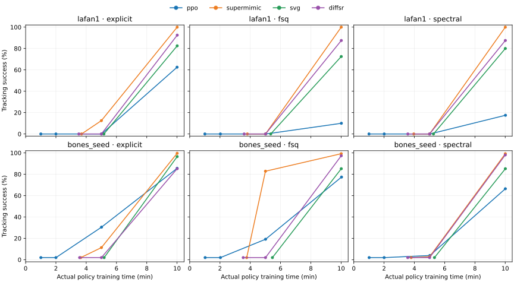
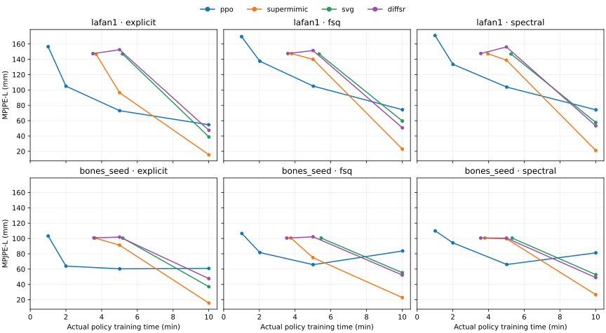

# G1 learning speed

These 24 measurements use the settings now selected by default: normalized
PPO inputs and a standard H100 profile for latent SVG/DiffSR. All policy runs
receive 600 training seconds. The original 24-run baseline and all 20 follow-up
runs are retained below, including unsuccessful configurations. This is one
seed on training motions, not an independent test of the chosen defaults.

SuperMimic reaches 99–100% success across both banks and all interfaces. The
two stalled LAFAN1 DiffSR arms improve from 0% to 87.5%. Latent PPO remains
slow: 10–17.5% LAFAN1 success at ten minutes, despite improved survival and
local error. These results are measurements, not 24 tracking-quality passes.

PPO retains its larger automatic profile because standard worsened all six
follow-up cases. Latent SVG/DiffSR use standard consistently on both banks.
For SVG this improves LAFAN1 by 22.5–30 points but reduces BONES-SEED by
3.5–6.6 points. BONES-SEED FSQ DiffSR gains success with worse global error;
these tradeoffs are included rather than selecting the best cell independently.

- [Original baseline: 24 runs](baseline/README.md)
- [Normalization and LAFAN1 sizing: 10 runs](diagnostics/README.md)
- [PPO and BONES-SEED sizing: 10 runs](validation/README.md)
- [Protocol and source provenance](../g1-learning-speed.md)
- [All selected aggregate measurements](summary.json)

## Final checkpoints

Each row uses one final checkpoint for all metrics. Training seconds are the
actual saved clock. End-to-end time adds encoder pretraining and policy startup;
it excludes queue and evaluation. Mean survival is capped by natural clip
completion, so BONES-SEED can have high success with a mean below ten seconds.

| Dataset | Command | Learner | Train s | Success % | L/G mm | Survival s | End-to-end min |
| --- | --- | --- | ---: | ---: | ---: | ---: | ---: |
| lafan1 | explicit | ppo | 600.10 | 62.5 | 54.7 / 394.0 | 8.82 | 12.69 |
| lafan1 | explicit | supermimic | 600.51 | 100.0 | 15.5 / 53.4 | 10.00 | 13.08 |
| lafan1 | explicit | svg | 600.59 | 82.5 | 38.8 / 258.4 | 9.69 | 13.07 |
| lafan1 | explicit | diffsr | 600.73 | 92.5 | 47.4 / 408.8 | 9.88 | 13.08 |
| lafan1 | fsq | ppo | 600.94 | 10.0 | 74.3 / 225.7 | 6.07 | 16.26 |
| lafan1 | fsq | supermimic | 600.44 | 100.0 | 23.0 / 64.5 | 10.00 | 16.52 |
| lafan1 | fsq | svg | 600.50 | 72.5 | 59.5 / 419.3 | 9.24 | 16.52 |
| lafan1 | fsq | diffsr | 600.70 | 87.5 | 50.7 / 262.0 | 9.66 | 16.53 |
| lafan1 | diffsr | ppo | 601.03 | 17.5 | 74.1 / 263.1 | 6.03 | 16.28 |
| lafan1 | diffsr | supermimic | 600.42 | 100.0 | 21.2 / 55.7 | 10.00 | 16.70 |
| lafan1 | diffsr | svg | 600.46 | 80.0 | 57.6 / 339.6 | 9.41 | 16.48 |
| lafan1 | diffsr | diffsr | 600.57 | 87.5 | 53.2 / 246.2 | 9.69 | 16.49 |
| bones_seed | explicit | ppo | 600.38 | 85.5 | 60.9 / 657.2 | 5.61 | 13.68 |
| bones_seed | explicit | supermimic | 600.47 | 99.6 | 15.7 / 75.5 | 5.96 | 14.02 |
| bones_seed | explicit | svg | 600.48 | 96.5 | 37.0 / 334.0 | 5.88 | 13.96 |
| bones_seed | explicit | diffsr | 600.38 | 85.2 | 47.6 / 375.2 | 5.61 | 13.89 |
| bones_seed | fsq | ppo | 601.55 | 77.3 | 83.7 / 667.2 | 5.25 | 19.06 |
| bones_seed | fsq | supermimic | 600.36 | 99.2 | 22.9 / 88.6 | 5.95 | 19.43 |
| bones_seed | fsq | svg | 600.58 | 85.2 | 55.3 / 226.9 | 5.58 | 19.08 |
| bones_seed | fsq | diffsr | 600.43 | 97.3 | 52.3 / 339.9 | 5.90 | 19.07 |
| bones_seed | diffsr | ppo | 600.58 | 66.4 | 81.2 / 456.6 | 4.75 | 19.06 |
| bones_seed | diffsr | supermimic | 600.45 | 99.2 | 26.7 / 116.5 | 5.95 | 19.55 |
| bones_seed | diffsr | svg | 600.64 | 85.2 | 52.8 / 268.9 | 5.56 | 19.20 |
| bones_seed | diffsr | diffsr | 600.26 | 98.0 | 49.0 / 298.1 | 5.92 | 19.19 |

## Timed checkpoints

Each cell is **success % / MPJPE-L mm @ actual training minutes**. Columns
use the first saved checkpoint at or after the requested time. Cold learner
compilation can cross multiple milestones. Repeated cells are one measurement,
not independent observations. The final table above can differ slightly from
the first checkpoint after 600 seconds.

## lafan1

| Learner / command | ≥1 min | ≥2 min | ≥5 min | ≥10 min | First ≥90% success |
| --- | --- | --- | --- | --- | --- |
| ppo / explicit | 0.0% / 156.5 @ 1.00 | 0.0% / 105.0 @ 2.00 | 0.0% / 73.0 @ 5.01 | 62.5% / 54.7 @ 10.00 | not reached |
| supermimic / explicit | 0.0% / 146.8 @ 3.69 | 0.0% / 146.8 @ 3.69 | 12.5% / 96.5 @ 5.00 | 100.0% / 15.5 @ 10.01 | 10.01 min |
| svg / explicit | 0.0% / 147.0 @ 5.17 | 0.0% / 147.0 @ 5.17 | 0.0% / 147.0 @ 5.17 | 82.5% / 38.8 @ 10.01 | not reached |
| diffsr / explicit | 0.0% / 147.4 @ 3.51 | 0.0% / 147.4 @ 3.51 | 0.0% / 152.6 @ 5.00 | 92.5% / 47.4 @ 10.01 | 10.01 min |
| ppo / fsq | 0.0% / 169.6 @ 1.00 | 0.0% / 137.5 @ 2.03 | 0.0% / 105.0 @ 5.03 | 10.0% / 74.3 @ 10.02 | not reached |
| supermimic / fsq | 0.0% / 147.5 @ 3.81 | 0.0% / 147.5 @ 3.81 | 0.0% / 140.0 @ 5.00 | 100.0% / 23.0 @ 10.01 | 10.01 min |
| svg / fsq | 0.0% / 147.0 @ 5.35 | 0.0% / 147.0 @ 5.35 | 0.0% / 147.0 @ 5.35 | 72.5% / 59.5 @ 10.01 | not reached |
| diffsr / fsq | 0.0% / 147.6 @ 3.60 | 0.0% / 147.6 @ 3.60 | 0.0% / 151.5 @ 5.01 | 87.5% / 50.7 @ 10.01 | not reached |
| ppo / diffsr | 0.0% / 171.1 @ 1.00 | 0.0% / 133.5 @ 2.01 | 0.0% / 103.8 @ 5.02 | 17.5% / 74.1 @ 10.02 | not reached |
| supermimic / diffsr | 0.0% / 147.4 @ 3.96 | 0.0% / 147.4 @ 3.96 | 0.0% / 138.9 @ 5.00 | 100.0% / 21.2 @ 10.01 | 10.01 min |
| svg / diffsr | 0.0% / 146.9 @ 5.26 | 0.0% / 146.9 @ 5.26 | 0.0% / 146.9 @ 5.26 | 80.0% / 57.6 @ 10.01 | not reached |
| diffsr / diffsr | 0.0% / 147.6 @ 3.57 | 0.0% / 147.6 @ 3.57 | 0.0% / 156.2 @ 5.00 | 87.5% / 53.2 @ 10.01 | not reached |

## bones_seed

| Learner / command | ≥1 min | ≥2 min | ≥5 min | ≥10 min | First ≥90% success |
| --- | --- | --- | --- | --- | --- |
| ppo / explicit | 2.0% / 103.2 @ 1.01 | 2.0% / 64.0 @ 2.00 | 30.5% / 60.4 @ 5.01 | 85.5% / 60.9 @ 10.01 | not reached |
| supermimic / explicit | 2.0% / 100.5 @ 3.64 | 2.0% / 100.5 @ 3.64 | 11.3% / 91.3 @ 5.00 | 99.6% / 15.7 @ 10.01 | 10.01 min |
| svg / explicit | 2.0% / 100.4 @ 5.18 | 2.0% / 100.4 @ 5.18 | 2.0% / 100.4 @ 5.18 | 96.5% / 37.0 @ 10.01 | 10.01 min |
| diffsr / explicit | 2.0% / 100.8 @ 3.57 | 2.0% / 100.8 @ 3.57 | 2.0% / 101.8 @ 5.00 | 85.2% / 47.6 @ 10.01 | not reached |
| ppo / fsq | 2.0% / 106.5 @ 1.02 | 2.0% / 81.6 @ 2.03 | 19.1% / 65.8 @ 5.01 | 77.3% / 83.7 @ 10.03 | not reached |
| supermimic / fsq | 2.0% / 100.6 @ 3.76 | 2.0% / 100.6 @ 3.76 | 82.8% / 74.9 @ 5.00 | 99.2% / 22.9 @ 10.01 | 10.01 min |
| svg / fsq | 2.0% / 100.5 @ 5.46 | 2.0% / 100.5 @ 5.46 | 2.0% / 100.5 @ 5.46 | 85.2% / 55.3 @ 10.01 | not reached |
| diffsr / fsq | 2.0% / 100.5 @ 3.53 | 2.0% / 100.5 @ 3.53 | 2.0% / 102.2 @ 5.01 | 97.3% / 52.3 @ 10.01 | 10.01 min |
| ppo / diffsr | 2.0% / 109.9 @ 1.01 | 2.0% / 94.3 @ 2.01 | 3.9% / 66.0 @ 5.02 | 66.4% / 81.2 @ 10.01 | not reached |
| supermimic / diffsr | 2.0% / 100.6 @ 3.79 | 2.0% / 100.6 @ 3.79 | 2.7% / 99.7 @ 5.01 | 99.2% / 26.7 @ 10.01 | 10.01 min |
| svg / diffsr | 2.0% / 100.4 @ 5.33 | 2.0% / 100.4 @ 5.33 | 2.0% / 100.4 @ 5.33 | 85.2% / 52.8 @ 10.01 | not reached |
| diffsr / diffsr | 2.0% / 100.6 @ 3.56 | 2.0% / 100.6 @ 3.56 | 2.0% / 100.5 @ 5.01 | 98.0% / 49.0 @ 10.00 | 10.00 min |

## Protocol and limits

Recorded training budgets (seconds): [600.0]; seeds: [42]; task: `imitation-g1-v1`. Requested checkpoint times (seconds): [60.0, 120.0, 300.0, 600.0]. Save at completed iteration boundaries and use the checkpoint clock, including learner compilation and checkpoint overhead. Startup ends after the first collected batch and is recorded separately. No evaluation runs inside the training clock. Model and execution settings are retained in each run's metadata.

Evaluate deterministic actions from frame zero without noise or randomization to the recorded horizon, or natural clip completion if shorter. The board sizes and horizons are listed below. These are training motions: this measures acquisition, not held-out generalization or full-bank coverage.

Success means no root tracking failure: absolute root-height error ≤0.25 m and absolute root R[2,2] error ≤0.8. MPJPE-L and MPJPE-G aggregate valid transitions before termination across the whole board, so failed runs contribute shorter trajectories. Read pose error together with success and survival time; lower error alone does not establish better tracking.

Threshold times are the first sampled checkpoints meeting the target, without interpolation. “Not reached” means no saved checkpoint met the target within this run; a transient crossing between checkpoints is unknown. One seed does not establish a statistically reliable learner ranking.

FSQ and DiffSR each use a dataset-specific frozen encoder; its pretraining record includes the update count and architecture. Encoder process time and policy startup are added separately for end-to-end time; queueing and evaluation are excluded. Reusing an encoder amortizes its cost across policies. All timing is specific to the recorded hardware, software, source snapshot, and compiler cache state. The cluster sweep uses separate cold compiler caches per job.

Raw BONES-SEED data, per-motion results, and model weights stay outside Git. Only aggregate measurements and hashes are published here.

## Cost and resolved execution

| Dataset | Command | Learner | Profile | Envs | Encoder min | Startup min | Last train min | Last end-to-end min | MPJPE-G mm | Mean survival s |
| --- | --- | --- | --- | --- | --- | --- | --- | --- | --- | --- |
| bones_seed | diffsr | diffsr | standard | 4096 | 5.45 | 3.74 | 10.00 | 19.19 | 298.1 | 5.92 |
| bones_seed | diffsr | ppo | large | 8192 | 5.45 | 3.60 | 10.01 | 19.06 | 456.6 | 4.75 |
| bones_seed | diffsr | supermimic | large | 8192 | 5.45 | 4.09 | 10.01 | 19.55 | 116.5 | 5.95 |
| bones_seed | diffsr | svg | standard | 4096 | 5.45 | 3.74 | 10.01 | 19.20 | 268.9 | 5.56 |
| bones_seed | explicit | diffsr | xlarge | 16384 | 0.00 | 3.89 | 10.01 | 13.89 | 375.2 | 5.61 |
| bones_seed | explicit | ppo | large | 8192 | 0.00 | 3.68 | 10.01 | 13.68 | 657.2 | 5.61 |
| bones_seed | explicit | supermimic | xlarge | 16384 | 0.00 | 4.01 | 10.01 | 14.02 | 75.5 | 5.96 |
| bones_seed | explicit | svg | xlarge | 16384 | 0.00 | 3.96 | 10.01 | 13.96 | 334.0 | 5.88 |
| bones_seed | fsq | diffsr | standard | 4096 | 5.39 | 3.67 | 10.01 | 19.07 | 339.9 | 5.90 |
| bones_seed | fsq | ppo | large | 8192 | 5.39 | 3.64 | 10.03 | 19.06 | 667.2 | 5.25 |
| bones_seed | fsq | supermimic | large | 8192 | 5.39 | 4.03 | 10.01 | 19.43 | 88.6 | 5.95 |
| bones_seed | fsq | svg | standard | 4096 | 5.39 | 3.68 | 10.01 | 19.08 | 226.9 | 5.58 |
| lafan1 | diffsr | diffsr | standard | 4096 | 3.55 | 2.92 | 10.01 | 16.49 | 246.2 | 9.69 |
| lafan1 | diffsr | ppo | large | 8192 | 3.55 | 2.70 | 10.02 | 16.28 | 263.1 | 6.03 |
| lafan1 | diffsr | supermimic | xlarge | 16384 | 3.55 | 3.13 | 10.01 | 16.70 | 55.7 | 10.00 |
| lafan1 | diffsr | svg | standard | 4096 | 3.55 | 2.92 | 10.01 | 16.48 | 339.6 | 9.41 |
| lafan1 | explicit | diffsr | xlarge | 16384 | 0.00 | 3.07 | 10.01 | 13.08 | 408.8 | 9.88 |
| lafan1 | explicit | ppo | large | 8192 | 0.00 | 2.69 | 10.00 | 12.69 | 394.0 | 8.82 |
| lafan1 | explicit | supermimic | xlarge | 16384 | 0.00 | 3.07 | 10.01 | 13.08 | 53.4 | 10.00 |
| lafan1 | explicit | svg | xlarge | 16384 | 0.00 | 3.06 | 10.01 | 13.07 | 258.4 | 9.69 |
| lafan1 | fsq | diffsr | standard | 4096 | 3.57 | 2.94 | 10.01 | 16.53 | 262.0 | 9.66 |
| lafan1 | fsq | ppo | large | 8192 | 3.57 | 2.68 | 10.02 | 16.26 | 225.7 | 6.07 |
| lafan1 | fsq | supermimic | xlarge | 16384 | 3.57 | 2.94 | 10.01 | 16.52 | 64.5 | 10.00 |
| lafan1 | fsq | svg | standard | 4096 | 3.57 | 2.94 | 10.01 | 16.52 | 419.3 | 9.24 |

## Provenance

Source fingerprint: `eea53176a120de7b1595e6401ab54db6dae02c53492ff981b63251505e0c6b1f`.

- lafan1: 40 clips, up to 500 steps (10 seconds), seed 42; `lafan1@0ff4dce7ae91`; manifest SHA-256 `ae7b212a370e98823592ec0532adb427c948197f5406937f3e79af8d7568167f`; board SHA-256 `0c3fd6e410f07588468bcb5ceedbe82617330fca2d6a12d69e34ae458585c668`.
- bones_seed: 256 clips, up to 500 steps (10 seconds), seed 42; `bones_seed_sonic_full_129785@e714bbff`; manifest SHA-256 `936799c1fd7621838b8ddbfd6d1230c0d1b4fbb142e3cd61b20843cc197610c5`; board SHA-256 `60cf8d4dfe9b16d80d07a8a8dd67c2305006205b3b2d95b755db5974e8e3f603`.

Recorded software: `{"isaaclab": "3.0.0", "mujoco": "3.12.0", "mujoco-warp": "3.12.0", "newton": "1.6.1", "tensordict": "0.13.0", "torch": "2.12.0+cu130", "torchrl": "0.13.3"}`.
