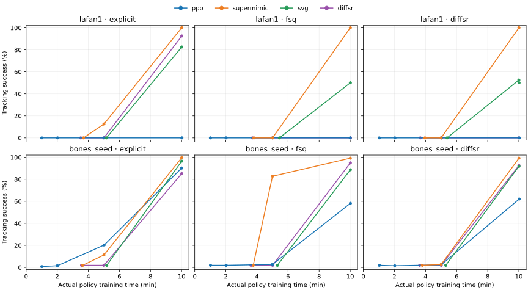
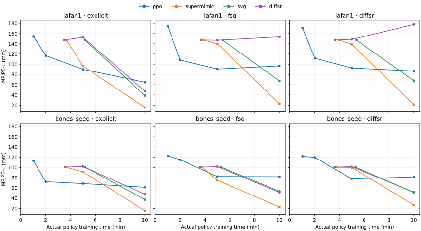

# H100 baseline learning speed

These are the original, unmodified 24 measurements from source commit
`64d70f422515bbd3e437790a44918c528ef20dc0`. PPO input normalization was
disabled; hardware sizing chose the largest estimated feasible profile.
Targeted follow-up runs are being checked separately.

24/24 cases completed. GPU: NVIDIA H100 80GB HBM3.

Each cell below is **tracking success % / MPJPE-L mm @ actual training minutes**.
A time column selects the first saved checkpoint at or after its requested time.
If one iteration crosses multiple times, the columns repeat that checkpoint; they are not independent measurements.
Missing measurements remain pending. A completed run is a measurement, not a claim of successful tracking.
Final checkpoints are checked for finite tensors and positive learner optimizer step counters, including the policy.

## lafan1

| Learner / command | ≥1 min | ≥2 min | ≥5 min | ≥10 min | First ≥90% success |
| --- | --- | --- | --- | --- | --- |
| ppo / explicit | 0.0% / 154.5 @ 1.01 | 0.0% / 116.7 @ 2.02 | 0.0% / 90.0 @ 5.02 | 0.0% / 64.7 @ 10.02 | not reached |
| supermimic / explicit | 0.0% / 146.8 @ 3.69 | 0.0% / 146.8 @ 3.69 | 12.5% / 96.5 @ 5.00 | 100.0% / 15.5 @ 10.01 | 10.01 min |
| svg / explicit | 0.0% / 147.0 @ 5.17 | 0.0% / 147.0 @ 5.17 | 0.0% / 147.0 @ 5.17 | 82.5% / 38.8 @ 10.01 | not reached |
| diffsr / explicit | 0.0% / 147.4 @ 3.51 | 0.0% / 147.4 @ 3.51 | 0.0% / 152.6 @ 5.00 | 92.5% / 47.4 @ 10.01 | 10.01 min |
| ppo / fsq | 0.0% / 174.3 @ 1.01 | 0.0% / 108.2 @ 2.01 | 0.0% / 90.7 @ 5.01 | 0.0% / 96.7 @ 10.00 | not reached |
| supermimic / fsq | 0.0% / 147.5 @ 3.81 | 0.0% / 147.5 @ 3.81 | 0.0% / 140.0 @ 5.00 | 100.0% / 23.0 @ 10.01 | 10.01 min |
| svg / fsq | 0.0% / 146.9 @ 5.45 | 0.0% / 146.9 @ 5.45 | 0.0% / 146.9 @ 5.45 | 50.0% / 67.4 @ 10.01 | not reached |
| diffsr / fsq | 0.0% / 147.4 @ 3.71 | 0.0% / 147.4 @ 3.71 | 0.0% / 146.9 @ 5.02 | 0.0% / 153.6 @ 10.02 | not reached |
| ppo / diffsr | 0.0% / 171.0 @ 1.03 | 0.0% / 111.6 @ 2.03 | 0.0% / 92.6 @ 5.02 | 0.0% / 86.6 @ 10.02 | not reached |
| supermimic / diffsr | 0.0% / 147.4 @ 3.96 | 0.0% / 147.4 @ 3.96 | 0.0% / 138.9 @ 5.00 | 100.0% / 21.2 @ 10.01 | 10.01 min |
| svg / diffsr | 0.0% / 147.0 @ 5.39 | 0.0% / 147.0 @ 5.39 | 0.0% / 147.0 @ 5.39 | 52.5% / 67.9 @ 10.00 | not reached |
| diffsr / diffsr | 0.0% / 147.4 @ 3.66 | 0.0% / 147.4 @ 3.66 | 0.0% / 148.6 @ 5.01 | 0.0% / 177.7 @ 10.01 | not reached |

## bones_seed

| Learner / command | ≥1 min | ≥2 min | ≥5 min | ≥10 min | First ≥90% success |
| --- | --- | --- | --- | --- | --- |
| ppo / explicit | 0.8% / 113.3 @ 1.01 | 1.6% / 72.1 @ 2.01 | 20.3% / 68.5 @ 5.02 | 90.2% / 61.2 @ 10.00 | 10.00 min |
| supermimic / explicit | 2.0% / 100.5 @ 3.64 | 2.0% / 100.5 @ 3.64 | 11.3% / 91.3 @ 5.00 | 99.6% / 15.7 @ 10.01 | 10.01 min |
| svg / explicit | 2.0% / 100.4 @ 5.18 | 2.0% / 100.4 @ 5.18 | 2.0% / 100.4 @ 5.18 | 96.5% / 37.0 @ 10.01 | 10.01 min |
| diffsr / explicit | 2.0% / 100.8 @ 3.57 | 2.0% / 100.8 @ 3.57 | 2.0% / 101.8 @ 5.00 | 85.2% / 47.6 @ 10.01 | not reached |
| ppo / fsq | 2.0% / 122.6 @ 1.01 | 2.0% / 115.0 @ 2.02 | 2.7% / 82.3 @ 5.00 | 58.2% / 81.8 @ 10.01 | not reached |
| supermimic / fsq | 2.0% / 100.6 @ 3.76 | 2.0% / 100.6 @ 3.76 | 82.8% / 74.9 @ 5.00 | 99.2% / 22.9 @ 10.01 | 10.01 min |
| svg / fsq | 2.0% / 100.5 @ 5.32 | 2.0% / 100.5 @ 5.32 | 2.0% / 100.5 @ 5.32 | 88.7% / 53.3 @ 10.01 | not reached |
| diffsr / fsq | 2.0% / 100.6 @ 3.61 | 2.0% / 100.6 @ 3.61 | 2.0% / 101.6 @ 5.01 | 94.9% / 51.4 @ 10.01 | 10.01 min |
| ppo / diffsr | 2.0% / 121.7 @ 1.03 | 1.6% / 119.6 @ 2.02 | 2.3% / 77.7 @ 5.00 | 62.1% / 81.3 @ 10.03 | not reached |
| supermimic / diffsr | 2.0% / 100.6 @ 3.79 | 2.0% / 100.6 @ 3.79 | 2.7% / 99.7 @ 5.01 | 99.2% / 26.7 @ 10.01 | 10.01 min |
| svg / diffsr | 2.0% / 100.5 @ 5.30 | 2.0% / 100.5 @ 5.30 | 2.0% / 100.5 @ 5.30 | 91.8% / 51.1 @ 10.01 | 10.01 min |
| diffsr / diffsr | 2.0% / 100.6 @ 3.62 | 2.0% / 100.6 @ 3.62 | 2.0% / 101.5 @ 5.01 | 92.6% / 51.4 @ 10.01 | 10.01 min |

## Protocol and limits

Recorded training budgets (seconds): [600.0]; seeds: [42]; task: `imitation-g1-v1`. Requested checkpoint times (seconds): [60.0, 120.0, 300.0, 600.0]. Save at completed iteration boundaries and use the checkpoint clock, including learner compilation and checkpoint overhead. Startup ends after the first collected batch and is recorded separately. No evaluation runs inside the training clock. Model and execution settings are retained in each run's metadata.

Evaluate deterministic actions from frame zero without noise or randomization to the recorded horizon, or natural clip completion if shorter. The board sizes and horizons are listed below. These are training motions: this measures acquisition, not held-out generalization or full-bank coverage.

Success means no root tracking failure: absolute root-height error ≤0.25 m and absolute root R[2,2] error ≤0.8. MPJPE-L and MPJPE-G aggregate valid transitions before termination across the whole board, so failed runs contribute shorter trajectories. Read pose error together with success and survival time; lower error alone does not establish better tracking.

Threshold times are the first sampled checkpoints meeting the target, without interpolation. “Not reached” means no saved checkpoint met the target within this run; a transient crossing between checkpoints is unknown. One seed does not establish a statistically reliable learner ranking.

FSQ and DiffSR each use a dataset-specific frozen encoder; its pretraining record includes the update count and architecture. Encoder process time and policy startup are added separately for end-to-end time; queueing and evaluation are excluded. Reusing an encoder amortizes its cost across policies. All timing is specific to the recorded hardware, software, source snapshot, and compiler cache state. The ICE sweep uses separate cold compiler caches per job.

Raw BONES-SEED data, per-motion results, and model weights stay outside Git. Only aggregate measurements and hashes are published here.

## Cost and resolved execution

| Dataset | Command | Learner | Profile | Envs | Encoder min | Startup min | Last train min | Last end-to-end min | MPJPE-G mm | Mean survival s |
| --- | --- | --- | --- | --- | --- | --- | --- | --- | --- | --- |
| bones_seed | diffsr | diffsr | large | 8192 | 5.45 | 4.06 | 10.01 | 19.51 | 313.3 | 5.80 |
| bones_seed | diffsr | ppo | large | 8192 | 5.45 | 2.85 | 10.03 | 18.33 | 391.7 | 4.56 |
| bones_seed | diffsr | supermimic | large | 8192 | 5.45 | 4.09 | 10.01 | 19.55 | 116.5 | 5.95 |
| bones_seed | diffsr | svg | large | 8192 | 5.45 | 4.03 | 10.01 | 19.48 | 237.6 | 5.72 |
| bones_seed | explicit | diffsr | xlarge | 16384 | 0.00 | 3.89 | 10.01 | 13.89 | 375.2 | 5.61 |
| bones_seed | explicit | ppo | large | 8192 | 0.00 | 3.69 | 10.00 | 13.69 | 759.6 | 5.72 |
| bones_seed | explicit | supermimic | xlarge | 16384 | 0.00 | 4.01 | 10.01 | 14.02 | 75.5 | 5.96 |
| bones_seed | explicit | svg | xlarge | 16384 | 0.00 | 3.96 | 10.01 | 13.96 | 334.0 | 5.88 |
| bones_seed | fsq | diffsr | large | 8192 | 5.39 | 3.10 | 10.01 | 18.49 | 283.1 | 5.83 |
| bones_seed | fsq | ppo | large | 8192 | 5.39 | 2.84 | 10.01 | 18.24 | 377.5 | 4.53 |
| bones_seed | fsq | supermimic | large | 8192 | 5.39 | 4.03 | 10.01 | 19.43 | 88.6 | 5.95 |
| bones_seed | fsq | svg | large | 8192 | 5.39 | 4.09 | 10.01 | 19.48 | 239.3 | 5.69 |
| lafan1 | diffsr | diffsr | xlarge | 16384 | 3.55 | 3.10 | 10.01 | 16.66 | 254.7 | 1.02 |
| lafan1 | diffsr | ppo | large | 8192 | 3.55 | 2.58 | 10.02 | 16.16 | 138.3 | 2.94 |
| lafan1 | diffsr | supermimic | xlarge | 16384 | 3.55 | 3.13 | 10.01 | 16.70 | 55.7 | 10.00 |
| lafan1 | diffsr | svg | xlarge | 16384 | 3.55 | 3.11 | 10.01 | 16.68 | 619.2 | 8.43 |
| lafan1 | explicit | diffsr | xlarge | 16384 | 0.00 | 3.07 | 10.01 | 13.08 | 408.8 | 9.88 |
| lafan1 | explicit | ppo | large | 8192 | 0.00 | 2.70 | 10.02 | 12.72 | 164.9 | 4.19 |
| lafan1 | explicit | supermimic | xlarge | 16384 | 0.00 | 3.07 | 10.01 | 13.08 | 53.4 | 10.00 |
| lafan1 | explicit | svg | xlarge | 16384 | 0.00 | 3.06 | 10.01 | 13.07 | 258.4 | 9.69 |
| lafan1 | fsq | diffsr | xlarge | 16384 | 3.57 | 3.12 | 10.02 | 16.71 | 240.2 | 1.03 |
| lafan1 | fsq | ppo | large | 8192 | 3.57 | 2.74 | 10.00 | 16.31 | 162.1 | 2.66 |
| lafan1 | fsq | supermimic | xlarge | 16384 | 3.57 | 2.94 | 10.01 | 16.52 | 64.5 | 10.00 |
| lafan1 | fsq | svg | xlarge | 16384 | 3.57 | 3.09 | 10.01 | 16.67 | 511.2 | 8.27 |

## Provenance

Source fingerprint: `eea53176a120de7b1595e6401ab54db6dae02c53492ff981b63251505e0c6b1f`.

- bones_seed: 256 clips, up to 500 steps (10 seconds), seed 42; `bones_seed_sonic_full_129785@e714bbff`; manifest SHA-256 `936799c1fd7621838b8ddbfd6d1230c0d1b4fbb142e3cd61b20843cc197610c5`; board SHA-256 `60cf8d4dfe9b16d80d07a8a8dd67c2305006205b3b2d95b755db5974e8e3f603`.
- lafan1: 40 clips, up to 500 steps (10 seconds), seed 42; `lafan1@0ff4dce7ae91`; manifest SHA-256 `ae7b212a370e98823592ec0532adb427c948197f5406937f3e79af8d7568167f`; board SHA-256 `0c3fd6e410f07588468bcb5ceedbe82617330fca2d6a12d69e34ae458585c668`.

Recorded software: `{"isaaclab": "3.0.0", "mujoco": "3.12.0", "mujoco-warp": "3.12.0", "newton": "1.6.1", "tensordict": "0.13.0", "torch": "2.12.0+cu130", "torchrl": "0.13.3"}`.
