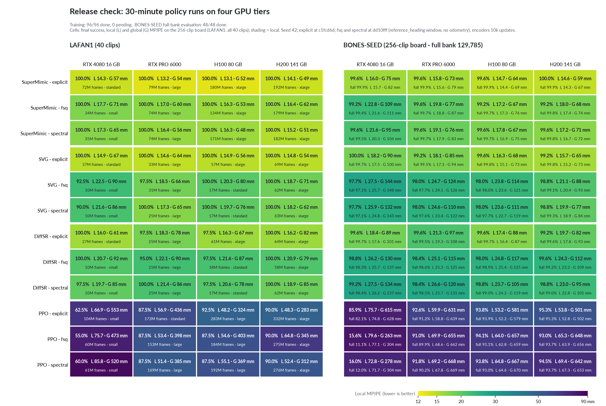

# G1 release check: 30-minute runs on four GPU tiers

Every learner (SuperMimic, SVG, DiffSR, PPO) with every interface (explicit,
FSQ, spectral) on both motion banks (LAFAN1, BONES-SEED), trained for 30
minutes on each of four GPUs: 96 policy runs, seed 42. All 96 completed. Every
BONES-SEED policy was also evaluated on the full bank of 129,785 clips.

These are single-seed measurements on training motions. They measure how fast
each learner acquires tracking on a given GPU, not held-out generalization and
not a statistically reliable ranking.

## What the runs show

- **SuperMimic tracks the full BONES-SEED bank on every tier.** Full-bank
  success is 99.4–99.9% with 14.3–21.6 mm local error, from a 16 GB RTX 4080
  to an H200.
- **Latent policies need no odometry.** FSQ and spectral policies here use the
  `reference_heading` encoder window, which reads only the reference motion.
  With SuperMimic they reach 99.4–99.8% full-bank success and 16.7–21.6 mm
  local error; explicit SuperMimic reaches 99.9% and 14.3–15.7 mm.
- **SVG and DiffSR** reach 97.1–99.8% full-bank success with 15.1–26.2 mm
  local error.
- **PPO does not reach 40 mm local error in 30 minutes on any tier.** On the
  RTX 4080 with latent interfaces it collects 22–23M frames on BONES-SEED and
  reaches 11–12% full-bank success; on the larger GPUs it reaches 90–95%.

## Protocol

| Setting | Value |
| --- | --- |
| Task | `imitation-g1-v1` |
| Policy budget | 1,800 training seconds per run; checkpoints requested at 60, 120, 300, 600, 900, 1,200 and 1,800 seconds |
| Seed | 42 |
| GPUs | NVIDIA GeForce RTX 4080 (16 GB); NVIDIA RTX PRO 6000 Blackwell (48 GB slice); NVIDIA H100 80 GB; NVIDIA H200 141 GB |
| Execution sizes | Automatic hardware sizing; resolved environment counts are in the last tables |
| Motion banks | LAFAN1 `lafan1@3d3066c39f5b`: 40 clips. BONES-SEED `bones_seed@eb0ad052afe7`: 129,785 clips |
| Evaluation boards | All 40 LAFAN1 clips; a fixed 256-clip BONES-SEED sample; the full BONES-SEED bank at the final checkpoint |
| Evaluation | Deterministic actions, frame-zero starts, no randomization, first 500 control steps (10 seconds) or natural clip completion |
| Encoders | One per bank and interface, 10,000 updates, pretrained once on an H200 (400–462 seconds) and frozen. Pretraining and startup are not part of the 30 minutes |

Success, local and global MPJPE are defined as in the
[30-minute learning-speed study](g1-learning-speed-30min.md).

**Source revisions.** Explicit runs use the first public release, commit
`c1fcd6d`. FSQ and spectral runs use the revision that makes
`reference_heading` the default encoder window; explicit runs were not
repeated at that revision. `summary.json` records the training-source
fingerprint of every run.

**Reruns.** Five runs on shared cluster GPUs are reruns, marked \* in the
tables. Four latent runs first ran at about half the usual frames per second
on one GPU while a neighbouring run on the same node ran at full speed; they
were repeated on other nodes and the reruns are reported. One explicit H100
run is a rerun from the first campaign. First-try results are kept outside Git.

## Final checkpoints

Cells are **success % / MPJPE-L mm / MPJPE-G mm** at the final checkpoint.

### LAFAN1, all 40 clips

| Learner | Interface | RTX 4080 16 GB | RTX PRO 6000 | H100 80 GB | H200 141 GB |
| --- | --- | ---: | ---: | ---: | ---: | 
| SuperMimic | explicit | 100.0 / 14.3 / 57 | 100.0 / 13.2 / 54 | 100.0 / 13.1 / 52 | 100.0 / 14.1 / 49 |
| SuperMimic | fsq | 100.0 / 17.7 / 71 | 100.0 / 17.0 / 60 | 100.0 / 16.3 / 53\* | 100.0 / 16.4 / 62\* |
| SuperMimic | spectral | 100.0 / 17.3 / 65 | 100.0 / 16.4 / 56 | 100.0 / 16.3 / 48 | 100.0 / 15.2 / 51 |
| SVG | explicit | 100.0 / 14.9 / 67 | 100.0 / 14.6 / 64 | 100.0 / 14.9 / 56 | 100.0 / 14.8 / 54 |
| SVG | fsq | 92.5 / 22.5 / 90 | 97.5 / 18.5 / 66 | 100.0 / 20.3 / 80 | 100.0 / 18.7 / 71 |
| SVG | spectral | 90.0 / 21.6 / 86 | 100.0 / 17.3 / 65 | 100.0 / 19.7 / 76 | 100.0 / 18.2 / 62 |
| DiffSR | explicit | 100.0 / 16.0 / 61 | 97.5 / 18.3 / 78 | 97.5 / 16.3 / 67 | 100.0 / 16.2 / 82 |
| DiffSR | fsq | 100.0 / 20.7 / 92 | 95.0 / 22.1 / 90 | 97.5 / 21.6 / 87 | 100.0 / 20.9 / 79 |
| DiffSR | spectral | 97.5 / 19.7 / 85 | 100.0 / 21.4 / 86 | 97.5 / 20.6 / 78 | 100.0 / 18.9 / 85\* |
| PPO | explicit | 62.5 / 66.9 / 553 | 87.5 / 56.9 / 436 | 92.5 / 48.2 / 324 | 90.0 / 48.3 / 283 |
| PPO | fsq | 55.0 / 75.7 / 473 | 87.5 / 53.4 / 398 | 87.5 / 54.6 / 403 | 90.0 / 64.8 / 345 |
| PPO | spectral | 60.0 / 85.8 / 520 | 87.5 / 51.4 / 385 | 87.5 / 55.1 / 369 | 90.0 / 52.4 / 312 |

### BONES-SEED, 256-clip board

| Learner | Interface | RTX 4080 16 GB | RTX PRO 6000 | H100 80 GB | H200 141 GB |
| --- | --- | ---: | ---: | ---: | ---: | 
| SuperMimic | explicit | 99.6 / 16.0 / 75 | 99.6 / 15.8 / 73 | 99.6 / 14.7 / 64\* | 100.0 / 14.6 / 59 |
| SuperMimic | fsq | 99.2 / 22.8 / 109 | 99.6 / 19.8 / 77 | 99.2 / 17.2 / 67 | 99.2 / 18.0 / 68\* |
| SuperMimic | spectral | 99.6 / 21.6 / 95 | 99.6 / 19.1 / 76 | 99.6 / 17.8 / 67 | 99.6 / 17.2 / 71 |
| SVG | explicit | 100.0 / 18.2 / 90 | 99.2 / 18.1 / 85 | 99.6 / 16.3 / 68 | 99.2 / 15.7 / 65 |
| SVG | fsq | 97.7 / 27.5 / 144 | 98.0 / 24.7 / 124 | 98.0 / 23.8 / 114 | 98.8 / 21.1 / 88 |
| SVG | spectral | 97.7 / 25.9 / 132 | 98.0 / 24.6 / 110 | 98.0 / 23.6 / 111 | 98.8 / 19.9 / 77 |
| DiffSR | explicit | 99.6 / 18.4 / 89 | 99.6 / 21.3 / 97 | 99.6 / 17.4 / 88 | 99.2 / 19.7 / 82 |
| DiffSR | fsq | 98.8 / 26.2 / 130 | 98.4 / 25.1 / 115 | 98.0 / 24.8 / 117 | 99.6 / 24.3 / 112 |
| DiffSR | spectral | 99.2 / 27.5 / 134 | 98.4 / 26.6 / 120 | 98.8 / 23.7 / 105 | 98.8 / 23.0 / 95 |
| PPO | explicit | 85.9 / 75.7 / 615 | 92.6 / 59.9 / 631 | 93.8 / 53.2 / 581 | 95.3 / 53.8 / 501 |
| PPO | fsq | 15.6 / 79.6 / 263 | 91.0 / 69.9 / 655 | 94.1 / 64.0 / 657 | 93.0 / 65.3 / 648 |
| PPO | spectral | 16.0 / 72.8 / 278 | 91.8 / 69.2 / 668 | 93.8 / 64.8 / 667 | 94.5 / 69.4 / 642 |

### BONES-SEED, full bank (129,785 clips)

| Learner | Interface | RTX 4080 16 GB | RTX PRO 6000 | H100 80 GB | H200 141 GB |
| --- | --- | ---: | ---: | ---: | ---: | 
| SuperMimic | explicit | 99.86 / 15.7 / 82 | 99.88 / 15.6 / 79 | 99.91 / 14.4 / 69\* | 99.92 / 14.3 / 67 |
| SuperMimic | fsq | 99.40 / 21.6 / 111 | 99.69 / 18.8 / 87 | 99.74 / 17.3 / 76 | 99.76 / 17.4 / 74\* |
| SuperMimic | spectral | 99.46 / 20.3 / 104 | 99.69 / 17.9 / 83 | 99.73 / 16.9 / 75 | 99.77 / 16.7 / 72 |
| SVG | explicit | 99.67 / 17.5 / 100 | 99.47 / 17.3 / 94 | 99.77 / 15.1 / 73 | 99.75 / 15.2 / 73 |
| SVG | fsq | 97.14 / 25.7 / 148 | 97.67 / 24.1 / 126 | 98.00 / 23.6 / 121 | 99.15 / 20.4 / 93 |
| SVG | spectral | 97.13 / 24.8 / 143 | 97.59 / 23.4 / 122 | 97.73 / 22.7 / 119 | 99.27 / 18.9 / 84 |
| DiffSR | explicit | 99.74 / 17.6 / 101 | 99.53 / 19.3 / 108 | 99.75 / 16.4 / 87 | 99.64 / 17.8 / 93 |
| DiffSR | fsq | 98.32 / 25.7 / 137 | 98.63 / 25.3 / 125 | 98.95 / 25.4 / 125 | 99.20 / 23.2 / 109 |
| DiffSR | spectral | 98.44 / 26.2 / 137 | 98.45 / 25.7 / 131 | 98.95 / 24.2 / 119 | 99.02 / 22.8 / 105 |
| PPO | explicit | 82.09 / 74.8 / 628 | 91.19 / 58.8 / 639 | 93.91 / 52.2 / 579 | 95.28 / 52.8 / 502 |
| PPO | fsq | 11.11 / 77.1 / 304 | 89.93 / 68.6 / 662 | 93.14 / 62.8 / 659 | 93.70 / 63.9 / 656 |
| PPO | spectral | 12.04 / 71.7 / 304 | 90.20 / 67.8 / 669 | 92.98 / 64.6 / 670 | 93.68 / 67.3 / 653 |

## Time to quality

### LAFAN1: first checkpoint (minutes) with ≥90% success and MPJPE-L ≤40 mm

| Learner | Interface | RTX 4080 16 GB | RTX PRO 6000 | H100 80 GB | H200 141 GB |
| --- | --- | ---: | ---: | ---: | ---: | 
| SuperMimic | explicit | 5 | 10 | 10 | 10 |
| SuperMimic | fsq | 5 | 10 | 10 | 10 |
| SuperMimic | spectral | 2 | 10 | 10 | 10 |
| SVG | explicit | 5 | 15 | 15 | 15 |
| SVG | fsq | 10 | 15 | 15 | 15 |
| SVG | spectral | 15 | 15 | 15 | 15 |
| DiffSR | explicit | 10 | 15 | 15 | 15 |
| DiffSR | fsq | 5 | 15 | 15 | 15 |
| DiffSR | spectral | 5 | 15 | 15 | 15 |
| PPO | explicit | – | – | – | – |
| PPO | fsq | – | – | – | – |
| PPO | spectral | – | – | – | – |

### BONES-SEED board: first checkpoint (minutes) with ≥90% success and MPJPE-L ≤40 mm

| Learner | Interface | RTX 4080 16 GB | RTX PRO 6000 | H100 80 GB | H200 141 GB |
| --- | --- | ---: | ---: | ---: | ---: | 
| SuperMimic | explicit | 5 | 10 | 10 | 10 |
| SuperMimic | fsq | 5 | 10 | 10 | 10 |
| SuperMimic | spectral | 5 | 10 | 10 | 10 |
| SVG | explicit | 10 | 15 | 10 | 10 |
| SVG | fsq | 10 | 15 | 15 | 15 |
| SVG | spectral | 10 | 15 | 15 | 15 |
| DiffSR | explicit | 10 | 15 | 10 | 15 |
| DiffSR | fsq | 10 | 15 | 15 | 15 |
| DiffSR | spectral | 10 | 15 | 15 | 15 |
| PPO | explicit | – | – | – | – |
| PPO | fsq | – | – | – | – |
| PPO | spectral | – | – | – | – |

Times are the requested checkpoint times; no crossing is interpolated. The
RTX 4080 runs use fewer parallel environments (see Throughput) and reach the
target at earlier checkpoints in several cases.

## Throughput

### LAFAN1: simulated frames in 30 minutes · parallel environments

| Learner | Interface | RTX 4080 16 GB | RTX PRO 6000 | H100 80 GB | H200 141 GB |
| --- | --- | ---: | ---: | ---: | ---: | 
| SuperMimic | explicit | 72M · 4096 | 79M · 8192 | 180M · 16384 | 192M · 16384 |
| SuperMimic | fsq | 34M · 1024 | 74M · 8192 | 134M · 16384 | 179M · 16384 |
| SuperMimic | spectral | 35M · 1024 | 74M · 8192 | 171M · 16384 | 182M · 16384 |
| SVG | explicit | 37M · 4096 | 33M · 8192 | 57M · 16384 | 69M · 16384 |
| SVG | fsq | 10M · 1024 | 31M · 8192 | 17M · 4096 | 62M · 16384 |
| SVG | spectral | 10M · 1024 | 25M · 8192 | 17M · 4096 | 63M · 16384 |
| DiffSR | explicit | 27M · 4096 | 25M · 8192 | 61M · 16384 | 64M · 16384 |
| DiffSR | fsq | 10M · 1024 | 25M · 8192 | 18M · 4096 | 58M · 16384 |
| DiffSR | spectral | 10M · 1024 | 25M · 8192 | 17M · 4096 | 62M · 16384 |
| PPO | explicit | 104M · 1024 | 173M · 4096 | 283M · 8192 | 332M · 16384 |
| PPO | fsq | 60M · 1024 | 153M · 8192 | 184M · 8192 | 275M · 16384 |
| PPO | spectral | 61M · 1024 | 169M · 8192 | 192M · 8192 | 276M · 16384 |

### BONES-SEED: simulated frames in 30 minutes · parallel environments

| Learner | Interface | RTX 4080 16 GB | RTX PRO 6000 | H100 80 GB | H200 141 GB |
| --- | --- | ---: | ---: | ---: | ---: | 
| SuperMimic | explicit | 69M · 4096 | 79M · 8192 | 177M · 16384 | 194M · 16384 |
| SuperMimic | fsq | 29M · 1024 | 57M · 4096 | 126M · 8192 | 175M · 16384 |
| SuperMimic | spectral | 28M · 1024 | 58M · 4096 | 95M · 8192 | 144M · 16384 |
| SVG | explicit | 33M · 4096 | 29M · 8192 | 68M · 16384 | 68M · 16384 |
| SVG | fsq | 9M · 1024 | 13M · 4096 | 17M · 4096 | 51M · 16384 |
| SVG | spectral | 9M · 1024 | 12M · 4096 | 16M · 4096 | 63M · 16384 |
| DiffSR | explicit | 27M · 4096 | 27M · 8192 | 69M · 16384 | 57M · 16384 |
| DiffSR | fsq | 9M · 1024 | 16M · 4096 | 17M · 4096 | 62M · 16384 |
| DiffSR | spectral | 9M · 1024 | 14M · 4096 | 18M · 4096 | 62M · 16384 |
| PPO | explicit | 100M · 1024 | 172M · 4096 | 264M · 8192 | 351M · 16384 |
| PPO | fsq | 23M · 1024 | 107M · 4096 | 188M · 8192 | 273M · 16384 |
| PPO | spectral | 22M · 1024 | 108M · 4096 | 186M · 8192 | 228M · 16384 |

## Files

- [Per-run results for all four tiers](g1-release-check/summary.json):
  final metrics, checkpoint curves, frames, resolved sizes, full-bank results
  and training-source fingerprints.
- [H100 cases in the learning-speed report format](g1-release-check/h100-summary.json):
  the input to the overview figure in the repository README. Its BONES-SEED
  points are the full-bank evaluation of each checkpoint; the 256-clip board
  values are kept beside them as `board_256`.

Raw motions, per-clip evaluations and model weights stay outside Git.
