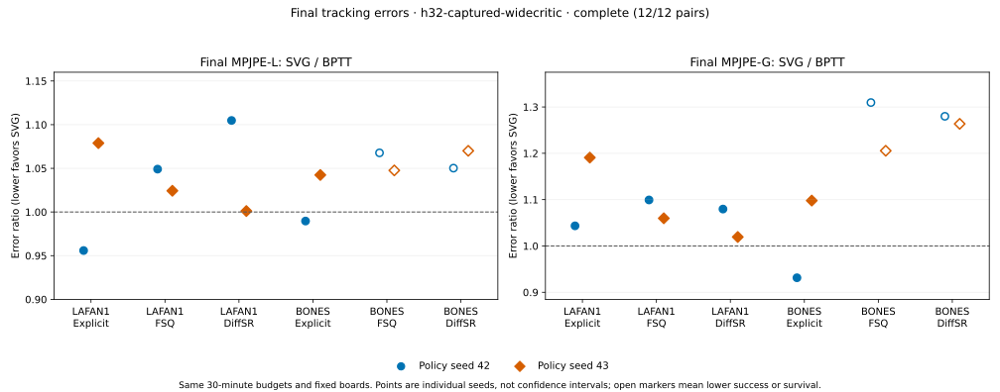
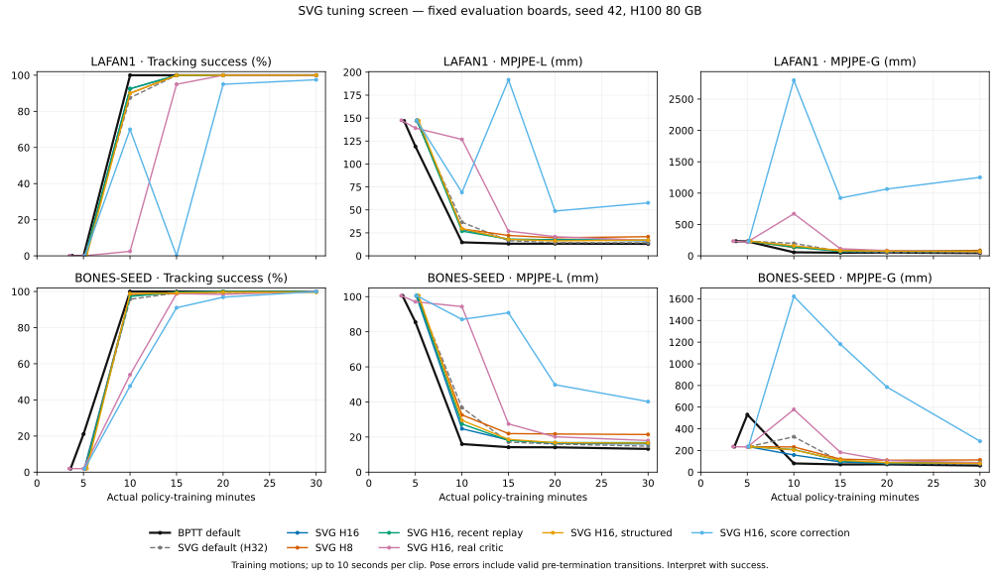
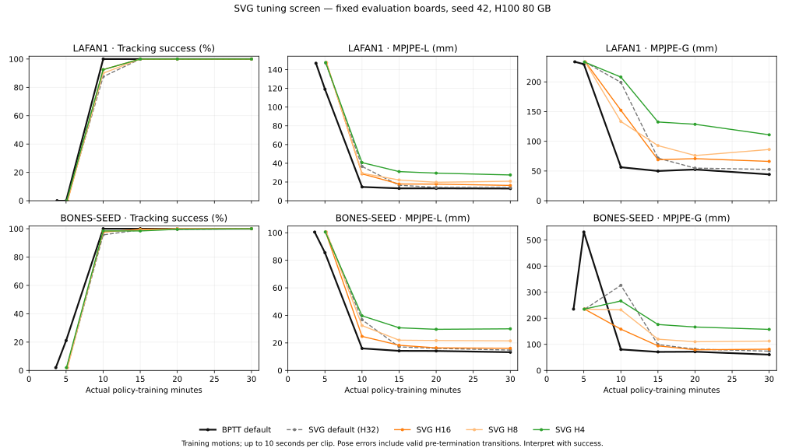
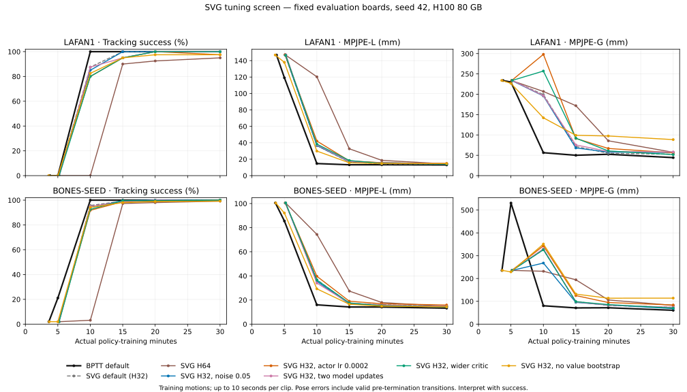
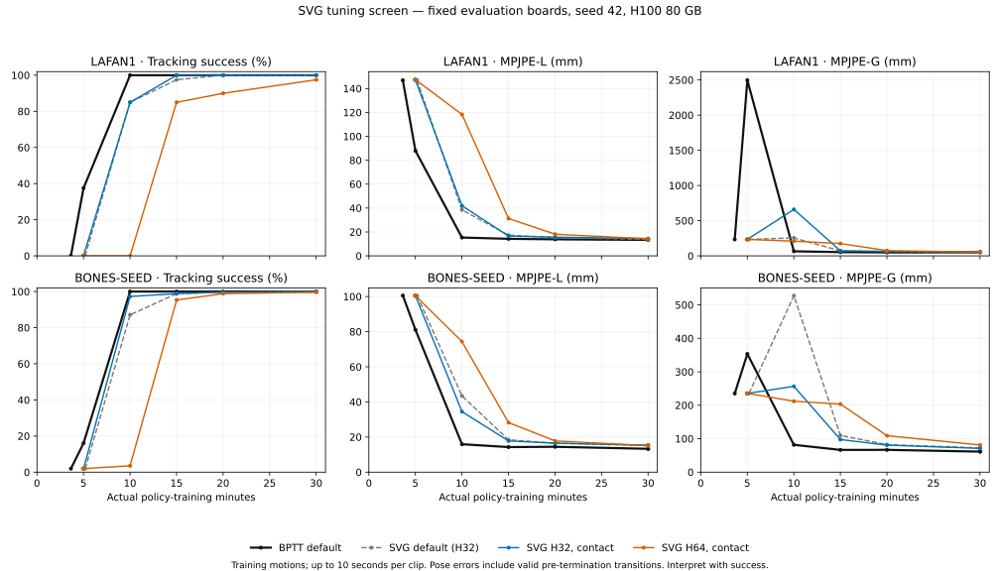
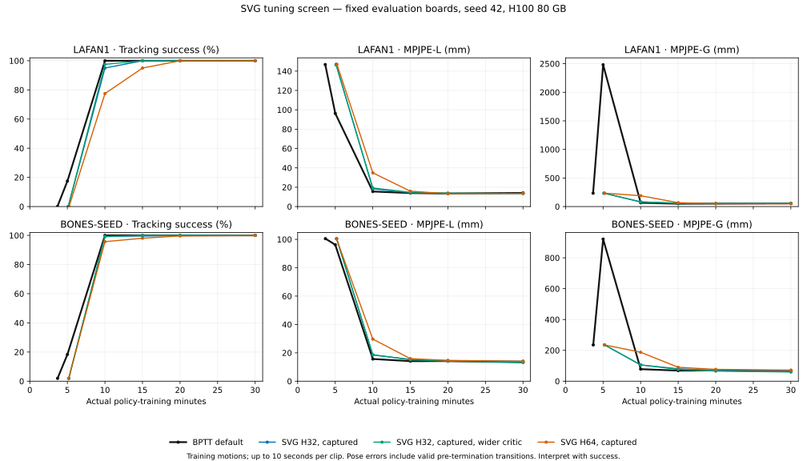

# SVG tuning: tracking results

**The completed search found no SVG tracking improvement that repeated across both seeds in any of the six dataset/interface cases.** The frozen finalist was captured H32 with a wider critic. BPTT had lower local and global pose error in all ten fresh matched pairs. BPTT remains the default.

Each screen run used one H100 80 GB, seed 42, explicit commands, and 1,800 policy-training seconds. Successful runs completed with positive actor, critic, and world-model optimizer counters, finite checkpoint tensors, and Slurm exit codes of 0:0. The first 32 attempts include two numerical failures; eight contact comparisons and eight captured-update comparisons completed. The initial 16-run screen is preserved below. See the [protocol](../svg-tuning.md).

## Final comparison across interfaces and seeds

The [final report](confirmation/README.md) covers both banks, explicit/FSQ/spectral commands, and policy seeds 42/43: 24 accepted runs, 12 matched pairs, and 132 evaluated checkpoints. Twenty runs are fresh; four explicit seed-42 runs are reused from selection. All use the same source archive and fixed evaluation boards; latent pairs share frozen encoder weights. No different recipe or checkpoint was chosen for individual cases.

SVG's BONES-SEED explicit seed-42 improvement did not repeat at seed 43. Its LAFAN1 explicit seed-42 result already traded lower local error for higher global error. BPTT had lower values of both errors in every fresh pair. On BONES-SEED with FSQ or spectral commands, SVG reached 253/256 successful clips (98.83%) in both seeds versus BPTT's 256/256; survival also decreased. The other pairs tied on success and survival. All runs first met 90% success plus local error at most 40 mm at approximately ten minutes, which does not erase the final tracking differences.

The [aggregate measurements](confirmation/confirmation.json) and [audit](confirmation/audit.json) preserve final-checkpoint hashes, optimizer evidence, actual clocks, source/runtime/encoder identities, and clean scheduler exits. All 96 reported threshold crossings were independently checked against raw measurements. These are two-seed acquisition results on fixed training-motion boards, with up to ten seconds per clip, not statistical significance or held-out generalization.

Errors below use each final checkpoint, in millimeters, over valid pre-termination transitions. Read them with success. The time column is the first observed checkpoint with at least 90% success and local error at most 40 mm; it is not an interpolated crossing.

## LAFAN1: 40 clips

| Configuration | Success | MPJPE-L | MPJPE-G | First 90% + 40 mm, min |
| --- | ---: | ---: | ---: | ---: |
| BPTT default | 100.00% | 13.06 | 44.27 | 10.01 |
| SVG default (H32) | 100.00% | 14.17 | 52.69 | 15.01 |
| SVG H16 | 100.00% | 16.35 | 66.17 | 10.00 |
| SVG H8 | 100.00% | 20.85 | 86.27 | 10.00 |
| SVG H16, recent replay | 100.00% | 17.20 | 72.29 | 10.00 |
| SVG H16, real critic | 100.00% | 16.84 | 65.89 | 15.00 |
| SVG H16, structured | 100.00% | 17.12 | 68.03 | 10.00 |
| SVG H16, score correction | 97.50% | 57.75 | 1251.77 | Not reached |

## BONES-SEED: 256 fixed clips

| Configuration | Success | MPJPE-L | MPJPE-G | First 90% + 40 mm, min |
| --- | ---: | ---: | ---: | ---: |
| BPTT default | 100.00% | 13.24 | 60.61 | 10.01 |
| SVG default (H32) | 100.00% | 14.79 | 73.95 | 10.00 |
| SVG H16 | 100.00% | 16.09 | 81.44 | 10.00 |
| SVG H8 | 100.00% | 21.45 | 112.62 | 10.00 |
| SVG H16, recent replay | 100.00% | 16.84 | 88.62 | 10.00 |
| SVG H16, real critic | 100.00% | 18.01 | 87.13 | 15.00 |
| SVG H16, structured | 99.61% | 16.53 | 80.33 | 10.00 |
| SVG H16, score correction | 100.00% | 40.20 | 285.41 | Not reached |

The score-correction arm illustrates why success alone is insufficient: BONES-SEED success reached 100%, while its final local/global errors were 40.20/285.41 mm. Its large errors are retained in the plots.

## Short-horizon follow-up

The four H1/H4 runs have finished. H4 achieved 100% success on both boards
but substantially worse pose error than H32 or BPTT. H1 produced non-finite
checkpoint tensors on both banks and failed validation; those runs have no
accepted tracking scores. Earlier checkpoints are not substituted for the
failed final checkpoints.

| Candidate | LAFAN1 success | LAFAN1 L / G, mm | BONES-SEED success | BONES-SEED L / G, mm |
| --- | ---: | ---: | ---: | ---: |
| SVG H4 | 100% | 27.53 / 110.92 | 100% | 30.23 / 157.46 |
| SVG H1 | Failed | — | Failed | — |

The [four aggregate records](horizon-extension.json) use the same source,
budget, boards, and BPTT controls as the initial screen. The accuracy refinements and separate contact-term comparison with fresh controls are complete below. Tracking quality determines selection; throughput is diagnostic.

## Accuracy refinements

All 12 refinement runs completed cleanly, with 62 evaluated checkpoints. The wider critic is the strongest common refinement by the geometric mean of final local/global error ratios across the two banks, after checking success and survival. It still trails BPTT on both errors on both banks. Lower action noise improves BONES-SEED but worsens LAFAN1 global error; longer H64 rollouts reduce final success.

| Configuration | LAFAN1 success | LAFAN1 L / G, mm | BONES-SEED success | BONES-SEED L / G, mm |
| --- | ---: | ---: | ---: | ---: |
| BPTT default | 100.00% | 13.06 / 44.27 | 100.00% | 13.24 / 60.61 |
| SVG default (H32) | 100.00% | 14.17 / 52.69 | 100.00% | 14.79 / 73.95 |
| SVG H32, noise 0.05 | 100.00% | 14.21 / 56.88 | 100.00% | 14.28 / 68.02 |
| SVG H32, actor LR 0.0002 | 97.50% | 14.94 / 56.20 | 100.00% | 15.85 / 83.81 |
| SVG H32, two model updates | 100.00% | 14.74 / 58.21 | 99.61% | 14.69 / 73.74 |
| SVG H32, wider critic | 100.00% | 14.17 / 51.65 | 100.00% | 14.31 / 70.25 |
| SVG H32, no value bootstrap | 97.50% | 14.70 / 88.58 | 99.22% | 14.32 / 113.99 |
| SVG H64 | 95.00% | 14.26 / 57.31 | 99.22% | 14.70 / 82.08 |

The [aggregate measurements](accuracy-refinements.json) retain every evaluated checkpoint, actual training time, survival, optimizer evidence, and provenance hashes. These runs share the initial screen's source and controls. The contact-term comparison below uses a newer source and fresh controls; the final comparison above followed selection.

## Contact-term comparison

All eight same-source comparisons completed, with 47 evaluated checkpoints. The contact term did not beat BPTT on either bank. H32 contact worsened both LAFAN1 errors; on BONES-SEED it traded higher local error for slightly lower global error relative to SVG without contact. H64 contact reduced success.

| Configuration | LAFAN1 success | LAFAN1 L / G, mm | BONES-SEED success | BONES-SEED L / G, mm |
| --- | ---: | ---: | ---: | ---: |
| BPTT default | 100.00% | 13.36 / 49.62 | 100.00% | 13.26 / 61.44 |
| SVG default (H32) | 100.00% | 13.71 / 53.96 | 100.00% | 15.05 / 72.42 |
| SVG H32, contact | 100.00% | 14.52 / 58.33 | 100.00% | 15.40 / 70.99 |
| SVG H64, contact | 97.50% | 14.18 / 53.12 | 99.61% | 15.05 / 81.13 |

These runs use source `bb0d1bea6740c3dfc53778cde412582078f32ed5`, fingerprint `732551fe202bc50a05096d88e33ae923d457c8fd7c76aed499be8780e89dd2e7`, and fresh controls. One BPTT allocation failed before training because CUDA was unavailable; a separate retry on another node supplies the LAFAN1 control. The [aggregate record](contact-screen.json) retains the failed attempt alongside every accepted measurement. Compare within this source group; do not attribute differences between its controls and the earlier controls to an algorithm change.

## Captured-update comparison

The final eight-case screen finished with 8 clean completions and 42 evaluated checkpoints. No candidate preserves success and survival while lowering both pose errors on both banks. Any lower individual error or higher update rate is reported as a partial improvement, not a general tracking win.

| Configuration | LAFAN1 success | LAFAN1 L / G, mm | BONES-SEED success | BONES-SEED L / G, mm |
| --- | ---: | ---: | ---: | ---: |
| BPTT default | 100.00% | 14.10 / 54.59 | 100.00% | 13.38 / 63.84 |
| SVG H32, captured | 100.00% | 13.62 / 53.18 | 100.00% | 14.10 / 67.18 |
| SVG H32, captured, wider critic | 100.00% | 13.48 / 56.96 | 100.00% | 13.25 / 59.45 |
| SVG H64, captured | 100.00% | 13.62 / 51.48 | 100.00% | 14.04 / 72.01 |

The frozen finalist was **SVG H32, captured, wider critic**. Selection first required no success/survival regression on either bank, then minimized the geometric mean of final local/global error ratios against BPTT (0.9792). That unchanged recipe was evaluated across both banks, all three interfaces, and policy seeds 42 and 43, with matching-source controls. A ratio below one alone does not establish a win on every metric or case; the final comparison above found no repeated advantage.

This group uses source `eaf9aa973ad307b015658dd3e806b0a4a69ad7f2` and fingerprint `df851c8eab98d88023a202d43e1bf53527874a1d767718c8c94ffb40452b0c7b` with fresh BPTT controls. The [aggregate records](captured-screen.json) preserve final-checkpoint selection, all measured points, source/encoder/board hashes, optimizer evidence, and any failed candidate. Earlier source groups remain separate. These are single-seed training-motion measurements; higher throughput is not the selection criterion. No default changes.

## BPTT reference repeats

The 12 BPTT reference cases cover both banks, all three interfaces, and policy seeds 42 and 43, with 73 evaluated checkpoints. Ten new runs complement the two explicit seed-42 contact controls. All accepted jobs finished with clean exits, finite checkpoints, and positive optimizer counters. The fixed evaluation board retains seed 42; latent runs reuse the same four frozen benchmark encoders.

| Dataset | Interface | Seed | Success | MPJPE-L, mm | MPJPE-G, mm | Survival, s |
| --- | --- | ---: | ---: | ---: | ---: | ---: |
| LAFAN1 | explicit | 42 | 100.00% | 13.36 | 49.62 | 10.000 |
| LAFAN1 | explicit | 43 | 100.00% | 12.90 | 47.26 | 10.000 |
| LAFAN1 | fsq | 42 | 100.00% | 17.91 | 44.55 | 10.000 |
| LAFAN1 | fsq | 43 | 100.00% | 18.67 | 45.32 | 10.000 |
| LAFAN1 | spectral | 42 | 100.00% | 18.44 | 41.95 | 10.000 |
| LAFAN1 | spectral | 43 | 100.00% | 17.78 | 41.39 | 10.000 |
| BONES-SEED | explicit | 42 | 100.00% | 13.26 | 61.44 | 5.959 |
| BONES-SEED | explicit | 43 | 100.00% | 13.47 | 63.89 | 5.959 |
| BONES-SEED | fsq | 42 | 99.22% | 18.56 | 54.65 | 5.948 |
| BONES-SEED | fsq | 43 | 100.00% | 18.63 | 60.90 | 5.959 |
| BONES-SEED | spectral | 42 | 100.00% | 17.16 | 49.99 | 5.959 |
| BONES-SEED | spectral | 43 | 100.00% | 17.25 | 50.89 | 5.959 |

These are reference measurements from the contact source, `bb0d1be`, with the same 30-minute budget. They are not paired controls for the newer captured-SVG source; the final comparison uses matching controls from that newer source. BONES-SEED survival can be below ten seconds because clips end at their available length. The [aggregate records](bptt-reference-repeats.json) retain every accepted checkpoint, frozen encoder hashes, source and submission provenance, and the original CUDA-unavailable allocation. Two seeds do not establish statistical significance.

## Scope and provenance

The SVG screens use one policy seed; the final comparison and BPTT reference repeats use two. These are acquisition measurements on training motions, not held-out generalization or full-bank coverage. Each clip starts at frame zero and runs for at most 10 seconds. The default BPTT recipe retains its model-only contact reward and captured updates; this compares complete recipes, not only gradient estimators. The SVG candidate screens use explicit commands; the final comparison and BPTT reference repeats also cover FSQ and spectral commands.

Initial-screen training source: `1f6e75c0711cce33ada4564db78880f3d7332405`. Source fingerprint: `77bf2292037789a09aaeaa566c90fe1121ba97d55940ad371496fdcdb6c942a8`. The [initial aggregate measurements](initial-screen.json) retain all 84 evaluated checkpoints, actual clocks, hardware/software records, optimizer evidence, and source/checkpoint hashes. Later source groups are identified above and in their records. Raw BONES-SEED records and checkpoints remain outside Git.
