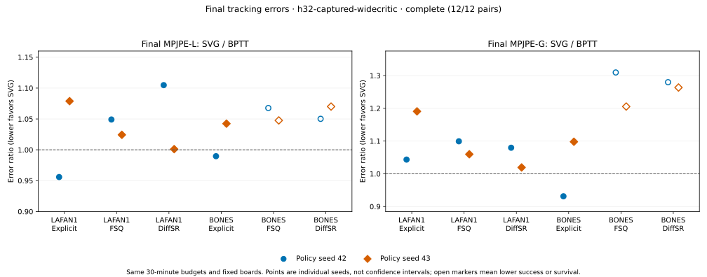
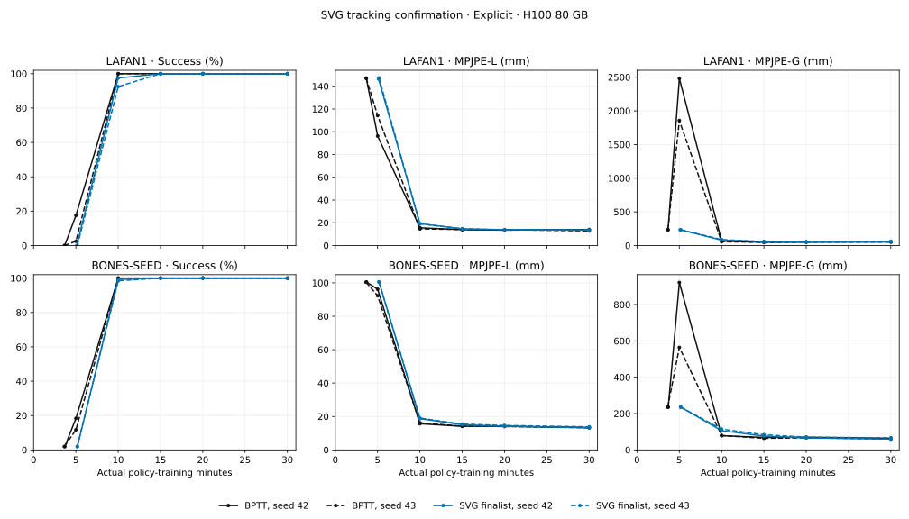
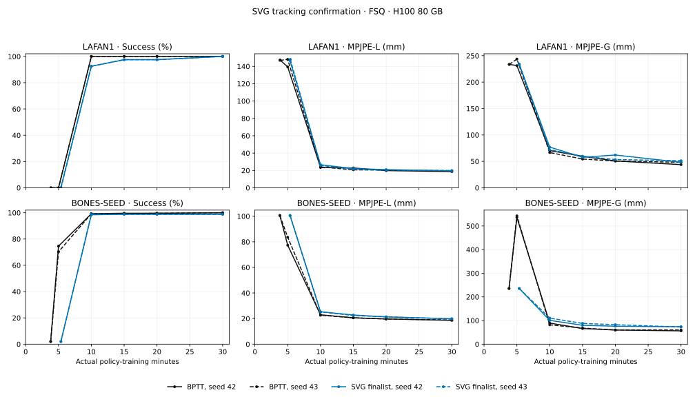
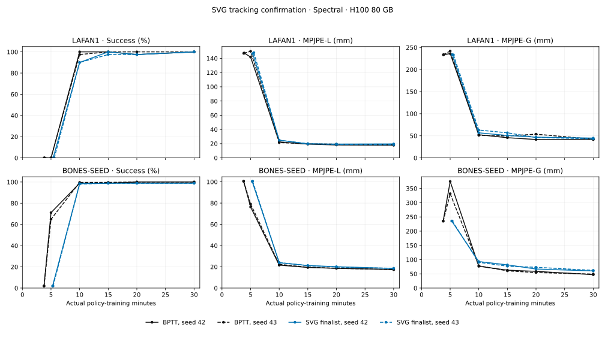

# SVG tracking confirmation

Status: **complete**; 12/12 matched dataset/interface/seed pairs.

Selected SVG configuration: **h32-captured-widecritic**. Replicated tracking improvements: **0/6 cases**. An improvement counts here only when success and survival are no worse and both pose errors are lower in each of the two seeds.

Each pair uses imitation-g1-v1 and final checkpoints after 1,800 policy-training seconds on H100 80 GB, fixed seed-42 evaluation boards, and identical frozen encoders where applicable. The six cases are evaluated with policy seeds 42 and 43. These are training-motion acquisition measurements, not held-out generalization or asymptotic convergence. Automatic hardware selection can choose different environment and batch sizes for the two learners; this compares complete training recipes, not an isolated actor-gradient estimator. The four explicit seed-42 runs are reused from the selection screen; the other twenty runs are fresh. Thus the explicit seed-42 scores are selection data, not an independent confirmation sample.

The boards contain all 40 LAFAN1 clips and 256 fixed BONES-SEED clips, each starting at frame zero and running for up to ten seconds. Pose errors are averaged over valid pre-termination transitions, not only successful clips. The earlier screening results and failures remain in the [full study](../README.md).

| Dataset | Interface | Both seeds complete | Tracking improvement in both seeds |
| --- | --- | --- | --- |
| LAFAN1 | Explicit | Yes | No |
| LAFAN1 | FSQ | Yes | No |
| LAFAN1 | Spectral | Yes | No |
| BONES-SEED | Explicit | Yes | No |
| BONES-SEED | FSQ | Yes | No |
| BONES-SEED | Spectral | Yes | No |



Ratios below one favor SVG on that error metric. Each point is one policy seed; the plot is not a confidence interval. Open markers flag lower success or survival. The table above applies the full tracking-improvement criterion.

| Dataset | Interface | Seed | Success SVG / BPTT | L SVG / BPTT, mm | G SVG / BPTT, mm | First 90% + 40 mm SVG / BPTT, min | Tracking win |
| --- | --- | ---: | ---: | ---: | ---: | ---: | --- |
| LAFAN1 | Explicit | 42 | 100.00% / 100.00% | 13.48 / 14.10 | 56.96 / 54.59 | 10.00 / 10.01 | No |
| LAFAN1 | Explicit | 43 | 100.00% / 100.00% | 13.88 / 12.86 | 61.39 / 51.55 | 10.00 / 10.00 | No |
| LAFAN1 | FSQ | 42 | 100.00% / 100.00% | 19.62 / 18.70 | 48.24 / 43.88 | 10.00 / 10.01 | No |
| LAFAN1 | FSQ | 43 | 100.00% / 100.00% | 19.93 / 19.45 | 51.22 / 48.33 | 10.00 / 10.01 | No |
| LAFAN1 | Spectral | 42 | 100.00% / 100.00% | 19.61 / 17.75 | 44.77 / 41.47 | 10.00 / 10.00 | No |
| LAFAN1 | Spectral | 43 | 100.00% / 100.00% | 18.40 / 18.38 | 43.02 / 42.20 | 10.00 / 10.01 | No |
| BONES-SEED | Explicit | 42 | 100.00% / 100.00% | 13.25 / 13.38 | 59.45 / 63.84 | 10.00 / 10.01 | Yes |
| BONES-SEED | Explicit | 43 | 100.00% / 100.00% | 13.81 / 13.25 | 66.45 / 60.52 | 10.00 / 10.00 | No |
| BONES-SEED | FSQ | 42 | 98.83% / 100.00% | 19.86 / 18.60 | 73.69 / 56.27 | 10.00 / 10.00 | No |
| BONES-SEED | FSQ | 43 | 98.83% / 100.00% | 19.77 / 18.87 | 72.66 / 60.27 | 10.00 / 10.00 | No |
| BONES-SEED | Spectral | 42 | 98.83% / 100.00% | 18.40 / 17.52 | 60.25 / 47.07 | 10.00 / 10.00 | No |
| BONES-SEED | Spectral | 43 | 98.83% / 100.00% | 18.60 / 17.38 | 62.18 / 49.21 | 10.00 / 10.00 | No |

A per-seed tracking win requires no lower success count or survival, and lower local and global pose error. A case needs that result in both seeds to support a replicated improvement here. Two seeds do not establish statistical significance or broader robustness. No checkpoint is selected retrospectively. All other outcomes are tradeoffs or regressions, even if throughput improves. The time column is the first observed checkpoint with at least 90% success and local error at most 40 mm; it is not an interpolated crossing or the selection criterion.

BPTT has lower local and global errors in 10/10 fresh matched pairs. The BONES-SEED explicit seed-42 SVG win did not repeat at seed 43; the LAFAN1 explicit seed-42 result trades lower local for higher global error. BPTT remains the default.

All LAFAN1 runs survive the full ten seconds. BONES-SEED BPTT and explicit SVG average 5.959 seconds, limited by the available clip lengths. The four BONES-SEED latent SVG runs average 5.934–5.936 seconds and succeed on 253/256 clips each (98.83%), versus BPTT's 256/256.







Frozen SVG overrides:

```text
agent.wm.critic_hidden=[512,256]
agent.wm.fused_adam=true
agent.wm.graph_early=true
agent.wm.no_sync=true
agent.wm.update_graphs=true
```

The BPTT control uses its default recipe. Apply these SVG overrides unchanged to the [public benchmark command](../../../training.md#measure-learning-speed); retain the reported frozen encoders, board seed, budget, and source revision for reproduction.

Training source: `eaf9aa973ad307b015658dd3e806b0a4a69ad7f2`. All 24 accepted runs use the same source archive and have clean scheduler exits, finite final checkpoints, and positive world-model, actor, and critic optimizer counters. Actual final training clocks are 1,800.27–1,800.77 seconds.

The [aggregate records](confirmation.json) contain all 132 checkpoint measurements, survival values, exact source/runtime/board/encoder hashes, resolved execution sizes, and separate encoder/startup costs. The [audit](audit.json) independently checks 96 quality thresholds and all final tracking comparisons against raw results. Proprietary raw motions, motion identifiers, per-motion outputs, and weights remain outside Git.
